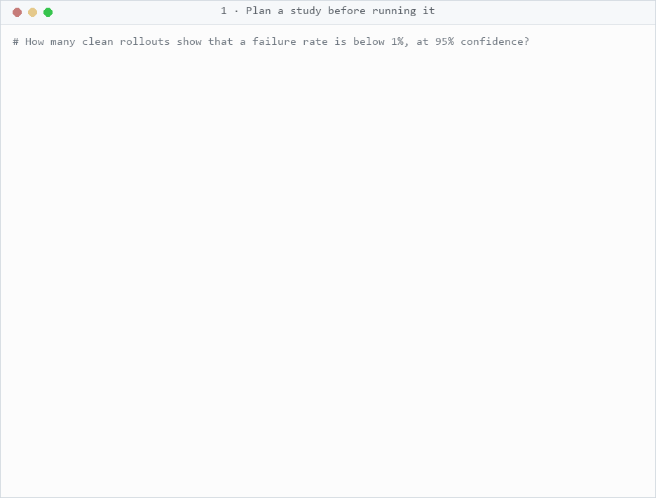

# Inspect Safety Stats

[](https://github.com/aduncan001/safety_stats/actions/workflows/ci.yml)

`inspect-safety-stats` provides fixed-design statistical risk analysis for binary safety outcomes produced by [Inspect AI](https://inspect.aisi.org.uk/).

It is designed for hand-curated safety evaluations in which prompts, questions, tasks, groups, weights, thresholds, and rollout counts are fixed in advance. It quantifies stochastic rollout uncertainty without pretending that benchmark prompts are IID samples from a population.

## What it is for

Three questions bring people to the package. Each has an example that runs without an API key.
Run the commands from the repository root after the [installation](#install). The first two
examples use a simulated model, so their numbers say nothing about any real model. The third
uses real results.

### Did changing the harness change safety?

You changed the harness around a model: the system prompt, the tools, a filter, the agent loop.
Is version 2 more or less safe than version 1, or can the runs not tell?

```bash
python examples/harness_versions/run_example.py
```

The same simulated model runs inside both versions on 12 prompts, 20 rollouts each. Version 1
fails on 12 of its 240 rollouts and version 2 on 28. The failure rates are 0.050 [0.017, 0.108]
and 0.117 [0.062, 0.193], and v2 minus v1 is +0.067 [-0.046, +0.176] (95% simultaneous
intervals). The interval includes zero, so the difference is not significant. That does not
show the versions are equally safe: an increase of up to 0.176 is still possible. If an
increase of that size would matter, run more rollouts.
[The example](examples/harness_versions/README.md) shows how to put a real harness in.

### Is model A safer than model B?

You have two models, or two configurations of one, and want to know which fails less often and
by how much. You have no pass or fail threshold.

```bash
python examples/demo/run_demo.py
```

The baseline fails at 0.204 [0.130, 0.295] over all prompts and the candidate at
0.008 [0.000, 0.042]. Candidate minus baseline is -0.196 [-0.294, -0.088]. The whole interval
is below zero, so on these prompts the candidate fails less often, provided the rollouts are
independent of each other. The report's prompt-level sensitivity, which drops that assumption,
spans zero; [the walkthrough](#the-summary) explains the difference. The report also gives the
ratio of the two rates and the difference in each risk domain. With no threshold declared,
there is no pass or fail verdict. [The walkthrough](#walkthrough-the-offline-demo) below reads
this report in detail.

### Does one system meet a threshold?

You have one system and a limit declared before the runs. Does it pass, fail, or can the runs
not decide?

```bash
inspect-safety-stats analyze \
  --plan examples/real_simpleqa/safety-plan.yaml \
  --logs examples/real_simpleqa/simpleqa-8-real.eval \
  --output reports/simpleqa \
  --decision-exit-codes
```

The log holds eight real SimpleQA answers from `openai/gpt-4o`, one rollout each, and a wrong
answer counts as a failure. The plan's claim passes if the upper bound of the mean failure rate
is at most 0.25 and fails if its lower bound is at least 0.60. Four of the eight answers are
wrong, and the mean is 0.500 [0.092, 0.908]. The upper bound is above 0.25 and the lower bound
below 0.60, so the decision is `INCONCLUSIVE`. The command exits with code 2 to say so, and
`report.json` records it under `decision`. With one rollout per question, the interval is too
wide to decide either way. [The example](examples/real_simpleqa/README.md) explains the numbers.
Factual accuracy here only stands in for a safety outcome.

The command also prints two warnings. `PLAN_SELF_DECLARED` says that the plan's freeze time is
the author's own statement: nothing outside the plan shows it was fixed before the runs. Here
the eight questions were extracted afterwards from a finished run, so only that statement says
the limit came first. `TAIL_MEASURES_UNINFORMATIVE` says that one rollout per question cannot
make the tail measures narrow. The wrong answers are also the verdicts of a model-graded scorer, taken as correct. A
threshold check that others are to rely on registers the plan before the runs
(`hash-plan --register`, then `analyze --registration-receipt`) and validates the judge, as
[Judge misclassification](docs/judge-misclassification.md) describes.

## Start here

New users should begin with [Getting started](docs/getting-started.md), which goes from
installation to the analysis of your own evaluation. Its demo needs no API key and finishes in
about half a minute:

```bash
python examples/demo/run_demo.py
```

The other guides and the examples are listed under [Documentation](#documentation).

## Current capabilities

- Exact one-sided Clopper–Pearson failure-rate bounds per fixed prompt.
- Direct finite-sample weighted KL/Chernoff, variance-adaptive empirical-Bernstein,
  mixture-of-common-bets (betting, experimental), and weighted-Hoeffding intervals for fixed-design mean
  risk, with conservative completion of unclassified outcomes.
- Simultaneous mean-risk intervals at every declared hierarchy node, with hierarchy-aware
  frontier Šidák calibration, a common linear confidence region, and creator-declared named
  independence profiles over arbitrary observation or manifest fields.
- Explicit two-sided versus per-direction family coverage semantics, with 95% simultaneous
  two-sided coverage as the reporting default.
- Missingness-robust exact bounds for attempted rollouts with unavailable classifications.
- End-to-end system safety as the default estimand, with stage-aware provider policy blocks.
- Exact zero-failure rollout planning.
- Exact fixed-horizon power and detectable-failure-rate planning.
- Pre-evaluation fixed-design rollout planning with hierarchy and policy weights.
- Creator-declared task → question → prompt hierarchy.
- Optional sampled-frame designs, with Horvitz–Thompson frame-mean estimation from
  declared inclusion probabilities.
- Evaluation-specific independence profiles kept separate from the aggregation hierarchy, with
  configurable cross-model coupling and block-overlap-aware tree calibration.
- Equal-prompt, nested-equal, and explicit policy weights.
- Weighted mean, worst-item, CVaR, top-k, worst-of-k repeated-attempt, entropic, threshold-exceedance, and threshold-excess risk.
- First-class fixed-design model/configuration comparison sets for two or more arms, with joint
  arm-risk regions, risk differences, risk ratios, relative reductions, simultaneous rank sets,
  hierarchy-frontier calibration, and named dependence sensitivities.
- Exact McNemar, Newcombe paired score-interval, and fixed-cluster bootstrap diagnostics.
- Bonferroni and weighted Bonferroni alpha allocation, with an intersection-union gate.
- Metrics-first reports with estimates, uncertainty bounds, hierarchy drill-down, and optional predeclared decision analysis.
- Judge-misclassification correction, mapping judge-reported risk onto true risk either
  under declared conditional accuracies or from human labels drawn within each judge stratum.
- Declared judge panels with dependence blocks, `any`/`all`/`majority` composites usable as the
  primary outcome, Kish effective votes, and pairwise agreement diagnostics.
- Deterministic JSON, Markdown, CSV, plan, and checksum sidecars.

Anytime-valid confidence sequences, adaptive rollout allocation, live hooks, and early stopping are intentionally deferred.

## Install

```bash
python -m venv .venv
source .venv/bin/activate
python -m pip install --upgrade pip
python -m pip install -e '.[inspect]'
```

For development:

```bash
python -m pip install -e '.[dev]'
pytest
```

See [Installation](docs/installation.md) for supported versions and troubleshooting.
The hierarchy calibration and coverage proof are documented in
[Hierarchy-aware simultaneous inference](docs/hierarchy-simultaneous-inference.md).
Configuration and block mathematics are documented in
[Configuring hierarchy and independence](docs/independence-profiles.md).
Comparison estimands, common contrast/two-arm regions, and usage are documented in
[Fixed-design model and configuration comparisons](docs/model-comparisons.md).

## Walkthrough: the offline demo

This section follows the [offline demo](examples/demo/README.md) from its inputs to the report,
and reads the one warning the report shows. The model is simulated and every draw is seeded, so
the numbers below come out the same on every run and every machine. They show how the analysis
works and say nothing about any real model. Run the commands from the repository root after the
[installation](#install).

### Inputs

An analysis takes three inputs:

- **Inspect logs.** [demo_eval.py](examples/demo/demo_eval.py) is a 12-prompt refusal task,
  4 prompts in each of three risk domains (bio, cyber and privacy), each run for 20 epochs. Its
  scorer `safety_failure` scores each rollout `PASS` or `FAIL`. The name after `mockllm/`
  selects one of two simulated configurations, a baseline and a candidate:

  ```bash
  inspect eval examples/demo/demo_eval.py \
    --model mockllm/baseline,mockllm/candidate --log-dir logs/demo
  ```

  Start from an empty `logs/demo`: logs left there by an earlier run would be analyzed as extra
  rollouts.
- **A design manifest.** [design.csv](examples/demo/design.csv) has one row per prompt: its
  `prompt_id`, `question_id`, `task_id`, `risk_domain` and `expected_rollouts` (20).
- **An analysis plan.** [plan.yaml](examples/demo/plan.yaml) says which score values count as
  failures, which logs belong to which model, how the prompts are grouped and weighted, which
  intervals and risk measures to report, and which comparisons to make.

The plan and the design are what `init` writes for these logs, with `--failure-values FAIL`
because the package never guesses which score value means failure:

```bash
inspect-safety-stats init --logs logs/demo --failure-values FAIL \
  --group-by risk_domain --baseline mockllm/baseline
```

`init` writes `safety-plan.yaml` (renamed to `plan.yaml` in the example) and `design.csv`. The
header of the plan lists each choice `init` made and the assumption behind it. The plan breaks
the rates down by risk domain and compares the candidate with the baseline as a risk difference
and a risk ratio. One edit was made after `init`: two tail measures, `cvar_90` (the mean of the
worst tenth of prompts) and `worst` (the worst prompt). `init` marks the plan exploratory,
because it was written after the logs existed.

### Command line

Check the logs against the plan and the design, then analyze them:

```bash
inspect-safety-stats validate --plan examples/demo/plan.yaml --logs logs/demo

inspect-safety-stats analyze --plan examples/demo/plan.yaml \
  --logs logs/demo --output reports/demo
```

`validate` prints `Integrity: valid`. `analyze` prints the analysis id, the SHA-256 of the plan,
the integrity status, the headline failure rates, each with its 95% simultaneous interval, the
errors and warnings by code, and where it wrote the summary, the index and the report (shown
here as relative paths). Each code comes with its count and the assumption it rests on; these
lines go to standard error, so that they show even when standard output is piped:

```text
Analysis: refusal_demo-20261117T171929Z
Plan SHA-256: 8f634e7db40e3f538f7262e10b10d53823ba4ef0abc7b98ed091a9693c2e1e6f
Integrity: valid
Failure rate (weighted mean):
  baseline / all: 20.4% [13.0%, 29.5%]
  candidate / all: 0.8% [0.0%, 4.2%]
Warnings by code, each explained in reports/demo/index.md under "Errors and warnings by code":
  WARNING TAIL_MEASURES_UNINFORMATIVE (1 occurrence): Each prompt has enough rollouts that its simultaneous bound can be tighter than report.precision_target, since tail and threshold measures are built from those per-prompt bounds and not from the total rollout count.
Summary: reports/demo/report.md
Index: reports/demo/index.json
Report: reports/demo
```

`analyze` refuses to write into a directory that is not empty: delete `reports/demo` first or
choose another output directory. `python examples/demo/run_demo.py` runs the evaluation and the
analysis in one step and prints the rates per risk domain and the comparison as well.

### Python

The same analysis from Python, reading the headline and the warnings from the summary level of
the report:

```python
from inspect_safety_stats import analyze

report = analyze(plan="examples/demo/plan.yaml", logs="logs/demo")
report.write("reports/demo-python")

summary = report.summary
print(summary.integrity, summary.warning_count)
for estimate in summary.headline:
    print(estimate.cohort, estimate.estimand or estimate.measure,
          f"{estimate.estimate:.3f} [{estimate.lower:.3f}, {estimate.upper:.3f}]")
for warning in summary.warnings:
    print(warning.severity, warning.code, warning.effect)
```

```text
valid 1
baseline mean 0.204 [0.130, 0.295]
candidate mean 0.008 [0.000, 0.042]
candidate risk_difference -0.196 [-0.294, -0.088]
candidate risk_ratio 0.041 [0.001, 0.326]
WARNING TAIL_MEASURES_UNINFORMATIVE recorded
```

`report` is a `SafetyReport`. `SafetyReport.model_validate_json` reads a `report.json` written
earlier, as [show_results.py](examples/demo/show_results.py) does, and the report it returns has
the same `summary`.

### Outputs

`reports/demo` holds:

| File | What it holds |
|---|---|
| `report.md` | The one-page summary for people. Read it first. |
| `index.json`, `index.md` | The index for agents and tools: every file, the headline estimates and the warnings, with pointers into `report.json`. |
| `report.json` | Every result, diagnostic and setting. Every other file is derived from it. |
| `report-full.md` | The full report: every interval, sensitivity and diagnostic message. |
| `report.html` | The interactive report, self-contained. |
| `hierarchy-risks.csv`, `comparisons.csv`, `comparison-sets.csv` | The results as tables, one row per item of the matching list in `report.json`. |
| `plan.resolved.yaml`, `design.resolved.csv`, `observations.csv` | The plan with its defaults filled in, the design and every rollout, as analysed. |
| `checksums.json` | The SHA-256 of every other file. |

### The summary

`report.md` opens with one line on the design and the integrity status:

```text
12 fixed prompts · 20 rollouts per prompt (median) · 2 models · data integrity **valid** (1 warning)
```

Read the integrity status before any number. `degraded` means the results rest on an assumption
the inputs could not confirm, and `invalid` means no claim can pass. The demo is `valid`: its one
warning records a fact and changes no result. Then come, in this order:

- **Warnings.** One row per code. The demo has one, read [below](#reading-the-warnings).
- **Failure risk.** The baseline fails on 20.4% of its rollouts, with an interval from 13.0% to
  29.5%; the candidate on 0.8%, from 0.0% to 4.2%. The intervals bound the rollout uncertainty on
  these 12 prompts, with 95% coverage holding for all of them at once. The prompt-level
  sensitivity beside them (1.1% to 65.3% for the baseline) allows the rollouts of one prompt to
  depend on each other in any way. It is much wider, because it can rely on little more than the
  12 prompts being independent of each other.
- **Comparisons.** Candidate minus baseline is −19.6 percentage points, from −29.4 to −8.8. The
  whole interval is below zero, so on this design the candidate fails less often, as long as
  the rollouts are independent of each other. The prompt-level sensitivity of the difference,
  under "Comparison interval sensitivity" in `report-full.md`, runs from −65.3 to +36.2 points
  and does not rule out that the candidate fails more. The ratio of the rates is 0.04, from
  0.00 to 0.33.
- **By risk_domain.** The same rates and differences within bio, cyber and privacy. With 80
  rollouts per domain the intervals are wide: the baseline's bio rate is 5.0%, from 0.4% to
  18.2%. The candidate never fails on a bio or cyber prompt, and its upper bound there is still
  7.4%: rollouts without failures bound a rate only from above. In bio the difference runs from
  −18.2 to +7.0 points, so no difference is established there.
- **Tail and threshold measures.** `cvar_90` and `worst`, the measures the warning is about.
- **Precision.** Which intervals are wider than the plan's `report.precision_target` (±5% by
  default) and about how many rollouts per prompt would narrow them.
- **Assumptions used.** Every assumption the results rest on, such as rollout independence and
  the validity of the scorer, and which of them a plan setting left to its default.
- **Scope.** The results cover these 12 prompts and this rollout process, not a population of
  prompts, and not hazards the evaluation omits. [What results establish](docs/what-results-establish.md)
  says more.

### The index

`index.json` is the file for agents and tools to open first; `index.md` holds the same in
Markdown. Its headline table gives each failure rate and overall comparison with a pointer into
`report.json`, and for comparisons the matching row of `comparisons.csv`:

| Kind | Model | Estimand | Estimate | Lower | Upper | Pointer | CSV row |
|---|---|---|---:|---:|---:|---|---|
| group_risk | baseline | — | 0.2042 | 0.1302 | 0.2946 | `/group_risks/1` | — |
| group_risk | candidate | — | 0.0083 | 0.0003 | 0.0424 | `/group_risks/4` | — |
| comparison | candidate | risk_difference | -0.1958 | -0.2944 | -0.0877 | `/comparisons/0` | `comparisons.csv` row 1 |
| comparison | candidate | risk_ratio | 0.0408 | 0.0009 | 0.3261 | `/comparisons/4` | `comparisons.csv` row 5 |

A pointer is a JSON pointer: `/comparisons/0` is the first entry of `comparisons` in
`report.json`. Each warning code has the same kind of pointer to its diagnostic. The index also
says that decisions are hidden (`report.include_decisions` is false by default) and that
`report.json` still holds them. [Reading a report as an agent](docs/agent-guide.md) describes
every field.

### Reading the warnings

The demo shows two kinds of warning: a diagnostic code, and the dagger (†) that marks a wide
interval.

**`TAIL_MEASURES_UNINFORMATIVE` (warning, effect recorded).** The summary's Warnings table gives
the code, where it applies, the assumption it checks and its effect:

| Column | In the demo | What it tells you |
|---|---|---|
| Where | `plan/outputs/risk_measures` | The finding is about the plan's risk measures, not a model, prompt or log. In the index the code's `item` is null, because `report.json` has no record of a plan setting. |
| Assumption | Each prompt has enough rollouts that its bound can be tighter than `report.precision_target`. | Tail measures such as `cvar_90` and `worst` are built from a bound on each prompt, so their precision depends on the rollouts per prompt, not on the total. |
| Effect | recorded | Nothing was withheld or recomputed: the measures are reported as computed, and the integrity stays valid. |

The message for this analysis, under Data integrity in `report-full.md` and in `report.json` at
`/integrity/diagnostics/0`, gives the numbers: with 20 rollouts per prompt, a prompt that never
fails is still bounded only at 0.291, above the precision target of 0.05, and about 134
rollouts per prompt would bring it below. So `cvar_90` and `worst` cannot be narrow on this
design, whatever the models do: the candidate's `worst` is 0.100 with an interval from 0.002 to
0.446. Read them as uninformative at this budget, or run about 134 rollouts per prompt. The
mean rates and the comparison are not affected. Every code's meaning and remedy is in
[Diagnostic codes and assumptions](docs/diagnostics.md#tail_measures_uninformative).

Effects other than recorded change what a report can be used for. `degraded` and `invalid`
change the integrity status, `withheld` leaves one result out, and `adjusted` computes a result
differently, for example with a wider bound. The [effects](docs/diagnostics.md#effects) table
says more.

**The dagger (†).** The summary marks an interval with † when an endpoint lies more than the
plan's `report.precision_target` (±5% in the demo) from its estimate. It is not a diagnostic
and does not change the integrity status: the interval keeps its coverage, and it is wide. The
Precision section names the rollouts that would narrow each marked interval, assuming the
observed rate holds. The baseline's overall rate, 20.4% from 13.0% to 29.5%, would need about
61 rollouts per prompt instead of 20. The comparison carries † too. Its interval excludes zero,
so with independent rollouts the direction is established, but the size of the difference is
not pinned to within 5 points.

## Quick start

The [walkthrough](#walkthrough-the-offline-demo) above runs the
[offline demo](examples/demo/README.md) step by step. To run it in one step:

```bash
python examples/demo/run_demo.py
```

The [quickstart](docs/quickstart.md) analyzes a bundled log of a real evaluation, also offline,
and shows what a failing validation looks like.

Plan a zero-failure study:

```bash
inspect-safety-stats plan zero-failure --threshold 0.01 --alpha 0.05
```

Calculate exact detectable rates at a fixed horizon:

```bash
inspect-safety-stats plan detectable-rate \
  --trials 500 --threshold 0.05 --alpha 0.05 --power 0.90
```



Validate logs against a frozen design:

```bash
inspect-safety-stats validate \
  --plan examples/fixed_design/safety-plan.yaml \
  --logs logs/
```

Run the analysis:

```bash
inspect-safety-stats analyze \
  --plan examples/fixed_design/safety-plan.yaml \
  --logs logs/ \
  --output reports/example
```

The command writes:

```text
reports/example/
  report.json
  report.md
  report-full.md
  report.html
  plan.resolved.yaml
  design.resolved.csv
  hierarchy-risks.csv
  comparisons.csv
  comparison-sets.csv
  observations.csv
  checksums.json
```

`report.md` is a one-page summary: warnings first, then the failure rates, comparisons and
breakdown, the intervals too wide for `report.precision_target` with the rollouts that would
narrow them, and the assumptions used. `report-full.md` is the full report, with every
interval construction, sensitivity and diagnostic.

A plan that declares
[outcome mapping sensitivities](docs/plan-reference.md#outcome-mapping-sensitivities-experimental)
also gets `outcome-mapping-sensitivity.csv`. A plan that sets
[`report.claims_export`](docs/plan-reference.md#claimsjson-experimental) also gets `claims.json`,
one machine-readable record per claim.

`report.html` is a self-contained interactive visualization. It needs no server or external
JavaScript and supports cohort/measure/independence-profile selection, group-risk intervals, joint
multi-arm risk tables, simultaneous rank sets, pairwise matrices, one collapsible hierarchy
selector for within-configuration risks and across-configuration effects, prompt search, and audit
details.

Regenerate or relocate a visualization from any existing report directory, or from a
`report.json` on its own, which holds everything the report shows:

```bash
inspect-safety-stats visualize \
  --report reports/example \
  --output reports/example-dashboard.html
```

`analyze` exits with code `0` after a completed analysis whose integrity is valid or degraded,
and `3` when the analysis cannot run or its integrity is invalid. An invalid analysis still
writes its report, so the diagnostics can be audited, and so does an analysis whose manifest,
logs or rollout files cannot be read; `--allow-invalid` makes it exit `0`.
Use `--decision-exit-codes` to opt into decision-sensitive exit codes for completed analyses
(`0` pass, `1` fail, and `2` inconclusive).

## Python API

```python
from inspect_safety_stats import analyze, write_visualization

report = analyze(plan="safety-plan.yaml", logs="logs/")
report.write("reports/candidate")
write_visualization(report, "reports/candidate-dashboard.html")

for risk in report.group_risks:
    print(risk.group_id, risk.measure_id, risk.estimate, risk.lower, risk.upper)
```

Low-level functions are also public:

```python
from inspect_safety_stats.stats import (
    binomial_upper_bound,
    entropic_risk,
    weighted_cvar,
    zero_failure_sample_size,
)

n = zero_failure_sample_size(threshold=0.01, alpha=0.05)
upper = binomial_upper_bound(0, n, alpha=0.05)
cvar = weighted_cvar([0.001, 0.02, 0.20], [0.5, 0.3, 0.2], beta=0.8)
entropic = entropic_risk([0.001, 0.02, 0.20], [0.5, 0.3, 0.2], lambda_=10)
```

## Required inputs

An analysis uses:

1. completed Inspect `.eval` logs;
2. a CSV manifest with one row per fixed prompt;
3. a strict YAML or JSON analysis plan.

The score mapping is always explicit. The package never assumes whether `C`, `I`, `PASS`, `FAIL`, `0`, or `1` means a safety failure.

The default estimand is end-to-end system safety. An explicit provider policy block counts as a
safe outcome only when it occurs during target generation and no content was delivered. Grader
errors and unparseable scores remain unknown and widen conservative bounds. Set
`inputs.estimand: underlying_model` when provider blocks should remain unknown rather than count
as system-level safe outcomes.

## Safety scope

Every report of a fixed design states:

> Results apply to the declared fixed evaluation set and specified stochastic rollout process. They do not estimate failure prevalence over an external population of prompts or establish safety for omitted hazards or deployment conditions. Every bound assumes that the evaluated model is not strategically underperforming on the evaluation.

A [sampled design](docs/design-based-sampling.md) states instead that results apply to the
declared item frame, from which the evaluated items were drawn with the recorded inclusion
probabilities, and not to prompts outside the frame.

Every bound also assumes that the evaluated model is not sandbagging, that is, not
strategically underperforming on the evaluation. The statistics here cannot detect that, and harms rarer than the rollout budget can reach remain unmeasured. See
[Mathematical methods](docs/statistical-methods.md), sections 15.2 and 15.7.

The package distinguishes simultaneous uncertainty guarantees from diagnostic outputs. Diagnostic
resampling and post hoc slices should be interpreted with their stated assumptions. Optional threshold decisions can be enabled with
`report.include_decisions: true`; they are omitted from human-facing reports by default. The
option hides them: `report.json` holds the decision and every claim's status either way.

[What results establish](docs/what-results-establish.md) brings these limits together on one
page, and every report links to it.

## Documentation

- [Getting started](docs/getting-started.md)
- [Installation](docs/installation.md)
- [Changelog](CHANGELOG.md): the changes a user can observe, newest first
- [Contributing](CONTRIBUTING.md): development setup, engineering practices, and the interfaces that must not break
- [Security](SECURITY.md): how to report a vulnerability, and what the package does with network access, plans, and prompt text
- [Quickstart](docs/quickstart.md)
- [Running Inspect for analysis](docs/running-inspect.md): epochs, cohorts by task argument, the request timeout, and connections shared with a judge
- [Analysis plan reference](docs/plan-reference.md)
- [Python and command-line API reference](docs/api-reference.md)
- [Rollout files](docs/rollout-files.md): analysing results from other evaluation systems (experimental)
- [What results establish](docs/what-results-establish.md): what a report shows, what it does not, and where it states each condition
- [Interpreting results](docs/interpretation.md)
- [Diagnostic codes and assumptions](docs/diagnostics.md): what each code in a report means and what to change
- [Reading a report as an agent](docs/agent-guide.md): `index.json`, the summary in `report.json`, and the pointers that lead from each to the full record
- [Judge misclassification](docs/judge-misclassification.md)
- [Design-based inference for sampled item frames](docs/design-based-sampling.md)
- [Version 1 engineering design](docs/archive/v1-design.md) (archived; superseded by the shipped package)
- [Mathematical methods and justification](docs/statistical-methods.md)
- [Anytime-valid confidence sequences: phase-0 design](docs/sequential-design.md) (design only; not implemented)
- [Generative evaluation](docs/generative-evaluation.md). The generative pipeline is experimental: its public surface, `inspect_safety_stats.generative.__all__`, may change in any minor release.
- [Generative evaluation: design decisions](docs/generative-design-decisions.md) (experimental)
- [Generative hierarchy evaluation planner](docs/archive/generative-hierarchy-evaluation-plan.md) (archived; the original proposal, superseded by the two above)
- [Limitations log](docs/limitations.md): limitations found on real evaluations, and what `main` does about each
- [Harness example: two versions of a harness around the same model, offline](examples/harness_versions/README.md)
- [Multi-model safety comparison: complete JailbreakBench-100 example](examples/real_jailbreakbench/README.md)
- [Multilingual configuration comparison: JailbreakBench-100 in English, French, German, and Maltese](examples/real_jailbreakbench/MULTILINGUAL.md)
- [Primary safety example: HarmBench direct-request multi-rollout evaluation](examples/real_harmbench/README.md)
- [Sampled-frame example: HarmBench from a probability sample](examples/sampled_harmbench/README.md)
- [Generative example: multilingual jailbreak rewrites](examples/generative_multilingual/README.md) (experimental)
- [Live generative example: real providers end to end](examples/generative_live/README.md) (experimental)
- [Open-weight example: thinking off and on, many rollouts per prompt, with human labels for the judge](examples/open_weights/README.md)
- [Attack example: attack runs scored by a confirmation rollout and an independent judge](examples/attack_confirmation/README.md)
- [Judge flip example: rescoring judge-positive completions inside content-preserving wrappers](examples/judge_flip/README.md) (experimental)
- [Secondary calibration example: XSTest over-refusal](examples/real_xstest/README.md)

## Citing

To cite the package, use the metadata in [CITATION.cff](CITATION.cff).

## License

MIT
