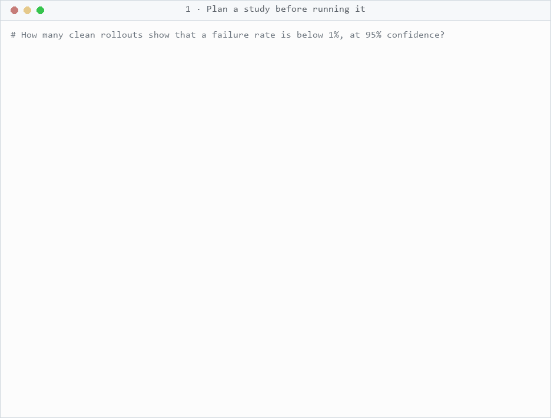
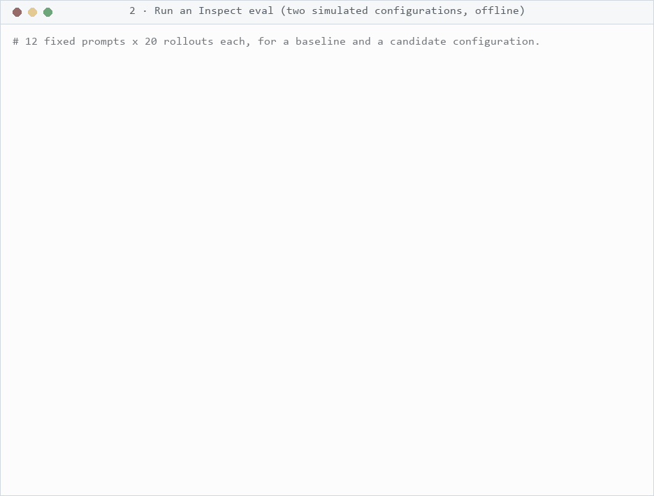
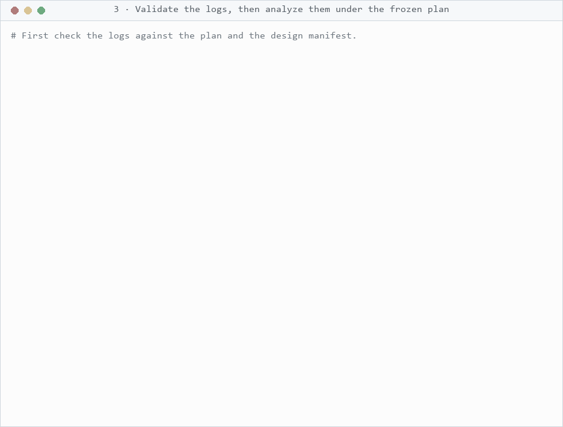
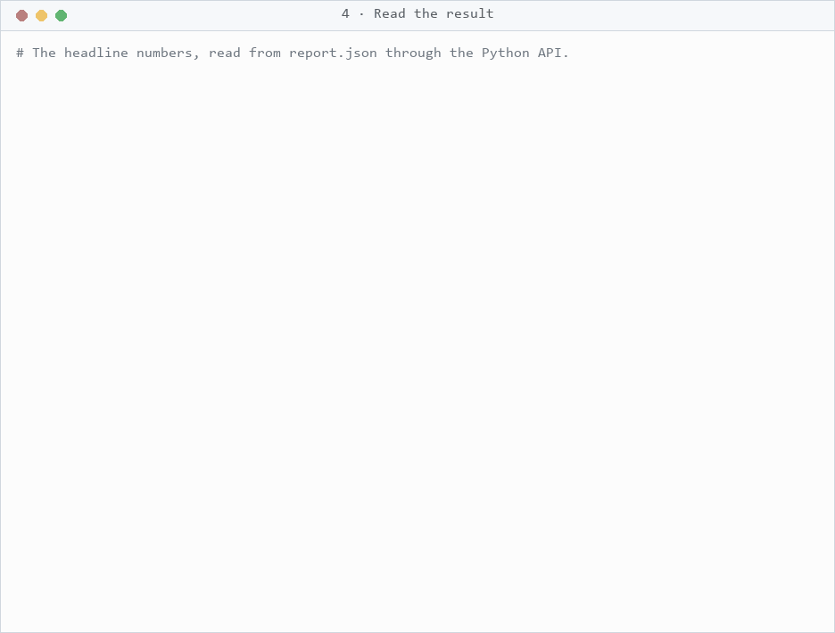

# Getting started

inspect-safety-stats analyzes [Inspect](https://inspect.aisi.org.uk/) evaluations in which every
prompt was run several times. It reports how often the model failed, with finite-sample bounds on
that rate. You fix the prompts and the analysis in advance, in a design manifest and a plan.
Unless you declare a sampled design, the package does not treat the prompts as a sample from a
larger population.

## Install

You need Python 3.11 or newer. The demo below needs no API key.

```bash
git clone https://github.com/aduncan001/safety_stats.git
cd safety_stats
python -m venv .venv
source .venv/bin/activate        # on Windows: .venv\Scripts\activate
python -m pip install -e '.[dev]'
```

If the installation fails, see [Installation](installation.md).

## Run the demo

```bash
python examples/demo/run_demo.py
```

The script runs a 12-prompt refusal evaluation in Inspect for two simulated configurations, a
baseline and a candidate. It then analyzes the logs and prints the comparison. The whole run takes
about half a minute, and the [demo README](../examples/demo/README.md) explains the simulation.

The recordings show the same steps one command at a time. Planning comes first: how many
failure-free rollouts it takes to show that a failure rate is below 1%, and which rates 500
rollouts can tell apart from a 5% threshold.



The evaluation itself is a plain `inspect eval` run, with 20 rollouts of each prompt for each
configuration.



`validate` checks the logs against the plan and the design manifest. `analyze` then writes the
report.



`show_results.py` prints the headline numbers from `report.json`.



The full report is `reports/demo/report.html`, a single file that opens in any browser. It adds
the bounds for every prompt and every level of the hierarchy, and the audit details.

## Reading the numbers

Each rate comes with a 95% interval. The intervals are simultaneous, meaning the 95% covers all
of them at once, so each one is wider than it would be on its own. In the demo the baseline fails
on 5% of its 80 bio rollouts, and its interval still reaches 0.31.

A prompt that never failed still has an upper bound above zero. After n rollouts without a
failure, the one-sided 95% upper bound is `1 - 0.05^(1/n)`, roughly 3/n, so 20 clean rollouts
rule out only rates above about 14%. `inspect-safety-stats plan zero-failure` works out how many
rollouts a given threshold needs.

A comparison uses the same prompts, with the same weights, for both configurations. In the demo
the whole interval for the difference (candidate minus baseline) lies below zero: on these
prompts, the candidate fails less often. The result does not extend to prompts outside the
evaluation.

Reports leave out pass and fail verdicts unless the plan sets `report.include_decisions: true`.
[Interpreting results](interpretation.md) goes into more detail.

## Your own evaluation

You need Inspect logs, a design manifest and a plan.

Run your task with `--epochs N --no-epochs-reducer`, so that the log holds N scored rollouts of
every prompt. Your scorer decides what counts as a failure, and the plan lists which of its
values are failures and which are safe. The package never guesses whether `C`, `I` or `FAIL`
means a failure.

The manifest is a CSV file with one row per prompt and columns for `prompt_id`, your hierarchy
(`question_id` and `task_id` in the demo), `expected_rollouts` and anything a group filters on.
It needs only the hierarchy levels your plan names; see the
[plan reference](plan-reference.md#inputs).
[examples/demo/design.csv](../examples/demo/design.csv) is a small one to start from.

In the plan, cohorts match logs to a model or configuration, and groups select the prompts to
report on. The plan also sets the comparisons and the confidence level. Copy
[examples/demo/plan.yaml](../examples/demo/plan.yaml) and adapt it; the
[plan reference](plan-reference.md) documents every field. Write the plan before you look at any
results.

Then run the evaluation and the analysis:

```bash
inspect eval my_task.py --model provider/model --epochs 20 --no-epochs-reducer --log-dir logs/mine
inspect-safety-stats validate --plan my-plan.yaml --logs logs/mine
inspect-safety-stats analyze --plan my-plan.yaml --logs logs/mine --output reports/mine
```

Fix anything `validate` reports as an error before you read the analysis. The
[quickstart](quickstart.md) goes through the same steps with a real provider.

## Finding what you need

- To check a failure rate against a threshold, add a claim with `acceptable_upper` to the plan.
  The [fixed-design example](../examples/fixed_design/README.md) has one.
- A comparison, like the one in the [demo](../examples/demo/README.md), shows whether a new
  configuration fails less often than the old one. [Model comparisons](model-comparisons.md)
  describes the estimands.
- Comparison sets rank several models or languages at once. The
  [JailbreakBench example](../examples/real_jailbreakbench/README.md) uses them.
- To find the weakest domain or prompt, declare groups and set `hierarchy_nodes: true`, then
  open the hierarchy view in `report.html`.
- When the tail matters more than the mean, use the CVaR, worst-item, entropic or threshold
  measures in [Statistical methods](statistical-methods.md).
- If an LLM judge scores the answers, read [Judge misclassification](judge-misclassification.md).
- Prompts sampled from a larger pool are covered by the
  [sampled HarmBench example](../examples/sampled_harmbench/README.md).
- For prompts generated from seeds, such as rewrites or translations, read
  [Generative evaluation](generative-evaluation.md).
- The [XSTest example](../examples/real_xstest/README.md) measures over-refusal.

## Contributing

Read [AGENTS.md](../AGENTS.md) first; it is short. [CONTRIBUTING.md](../CONTRIBUTING.md) has the
full rules. Before you open a pull request, run:

```bash
ruff check src tests examples research scripts
mypy src/inspect_safety_stats
pytest
```
