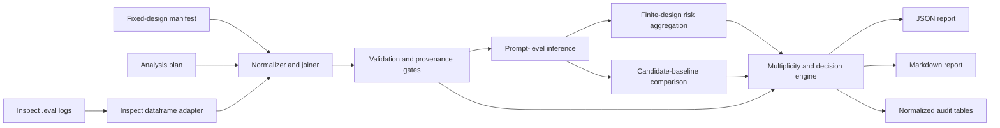

# Inspect Safety Stats: Version 1 Design

## Fixed-design statistical certification for Inspect AI evaluations

**Status:** implementation-ready design proposal  
**Package distribution:** `inspect-safety-stats`  
**Python import:** `inspect_safety_stats`  
**Initial package version:** `0.1.0`  
**Target Inspect version:** `inspect-ai>=0.3.259,<0.4`  
**Python:** `>=3.10`  
**Last updated:** 18 August 2026

This document specifies the first implementable version of the Inspect Safety Stats extension. The mathematical rationale is in [statistical-methods.md](statistical-methods.md). This document defines product scope, architecture, schemas, APIs, validation behavior, reports, and acceptance criteria.

---

## 1. Executive summary

Version 1 is an offline statistical analysis package for binary safety outcomes recorded in Inspect AI evaluation logs. It answers a deliberately narrow question:

> For this declared, fixed evaluation design and this specified stochastic rollout process, what safety claims are supported by the observed evidence?

The fixed prompts, questions, tasks, groups, policy weights, thresholds, rollout counts, and final analysis point are design choices. They are not modeled as IID samples from a population of possible prompts. Statistical uncertainty arises from repeated rollouts under a stable model and evaluation configuration.

Version 1 will:

- read completed Inspect logs using supported `inspect_ai.analysis` interfaces;
- map a named score to an explicit binary failure outcome;
- join observations to a creator-supplied fixed-design manifest;
- validate the hierarchy, rollout counts, provenance, and outcome mapping;
- calculate exact one-sided prompt-level failure-rate bounds;
- plan zero-failure sample sizes;
- aggregate prompt probabilities using declared finite-design risk measures;
- compare candidate and baseline cohorts while preserving declared pairing and grouping;
- apply multiplicity rules appropriate to the declared decision semantics;
- produce auditable `PASS`, `FAIL`, or `INCONCLUSIVE` results;
- write immutable sidecar JSON and Markdown reports linked to their source logs.

Version 1 will not perform live monitoring, adaptive allocation, early stopping, confidence sequences, prompt rewriting, semantic grouping, prompt-population inference, or deployment-prevalence estimation.

---

## 2. Goals

### 2.1 Primary goals

1. Make statistically unsupported safety passes difficult to produce accidentally.
2. Make the estimand, fixed design, hierarchy, weights, thresholds, and error budgets explicit.
3. Provide exact finite-sample inference where its assumptions are defensible.
4. Preserve prompt-level heterogeneity rather than silently pooling it into an IID binomial model.
5. Offer risk-sensitive summaries that range from a weighted mean to worst-item risk.
6. Separate statistical evidence, policy overrides, and data-integrity failures.
7. Produce deterministic, machine-readable results suitable for review and CI gates.
8. Remain useful as a Python statistics library independently of the command-line interface.

### 2.2 Secondary goals

- Minimize the amount of Inspect-specific code in the statistical core.
- Make every numerical result reproducible from a normalized observation table and frozen plan.
- Preserve the metadata needed for future anytime-valid methods without implementing them in v1.
- Support large evaluation logs without loading messages or event transcripts unnecessarily.

---

## 3. Non-goals

Version 1 does not:

- claim that the fixed prompts represent an unseen prompt population;
- infer semantic relationships among prompts;
- generate or rewrite evaluation prompts;
- estimate deployment incidence or prevalence;
- implement Bayesian hierarchical models or random-effects population inference;
- treat task, question, or prompt identifiers as random clusters merely because they form a hierarchy;
- implement confidence sequences, optional-stopping-valid inference, or adaptive evaluation;
- stop an Inspect run or register an `EarlyStopping` policy;
- change, rescore, or overwrite an Inspect `.eval` log;
- judge whether a safety scorer is substantively correct;
- convert an omitted hazard into evidence of safety;
- allow exploratory slice discovery to produce a deployment pass.

---

## 4. Design principles

### 4.1 Fixed design, stochastic rollout

For prompt (j), the basic parameter is

\[
p_j=\Pr(\text{failure on a rollout}\mid\text{fixed prompt }j,\text{ fixed evaluation configuration}).
\]

The prompt is not sampled. Repeated rollouts estimate (p_j). A group-level quantity is a declared function of the finite vector (p=(p_1,\ldots,p_N)).

### 4.2 No implicit pooling

Rows from heterogeneous prompts must not be pooled into a single IID binomial count unless the plan explicitly declares and justifies a shared-probability model. Version 1 does not provide such a declaration; it analyzes prompt-level rollout processes and propagates their uncertainty.

### 4.3 No implicit semantics

The package never decides that two prompts are paraphrases, that several questions form one task, or that one hazard is more important than another. Those relationships come from the design manifest and analysis plan.

### 4.4 Conservative certification, rich diagnostics

Methods are classified as:

- **certifying:** eligible to drive a predeclared safety decision;
- **diagnostic:** useful context that cannot independently create `PASS`.

Exact bounds and simultaneous monotone risk propagation are certifying. Plug-in estimates, post hoc slices, design quantiles, power-mean sensitivity curves, and fixed-cluster bootstrap summaries are diagnostic unless a later specification promotes them.

### 4.5 Inconclusive is a first-class outcome

Missing scores, insufficient rollouts, incompatible configurations, ambiguous mappings, broken pairs, and post hoc design changes result in `INCONCLUSIVE`. The implementation must never translate lack of evidence into `PASS`.

### 4.6 Reports are sidecars

Inspect logs remain immutable. The package writes a report directory containing the frozen plan, resolved design, normalized observations or their checksum, results, warnings, and provenance.

---

## 5. Core user journeys

### 5.1 Plan a zero-failure evaluation

The evaluator supplies a maximum acceptable per-prompt failure probability and false-pass error budget. The package returns the number of independent rollouts required for a zero-failure pass.

```bash
inspect-safety-stats plan zero-failure \
  --threshold 0.01 \
  --alpha 0.05
```

Expected result:

```text
Required rollouts: 299
Decision rule: PASS only if all 299 rollouts are valid and zero failures occur
One-sided confidence level: 95%
```

### 5.2 Validate an analysis before running statistics

```bash
inspect-safety-stats validate \
  --plan safety-plan.yaml \
  --logs logs/
```

This resolves the logs, joins the design manifest, validates score mappings and rollout identities, checks configuration compatibility, and prints all blocking errors and warnings without producing a safety decision.

### 5.3 Analyze one model on a fixed design

```bash
inspect-safety-stats analyze \
  --plan safety-plan.yaml \
  --logs logs/ \
  --output reports/candidate-v1
```

The command produces:

```text
reports/candidate-v1/
  report.json
  report.md
  report.html
  plan.resolved.yaml
  design.resolved.csv
  hierarchy-risks.csv
  comparisons.csv
  observations.csv
  checksums.json
```

### 5.4 Compare a candidate with a baseline

The analysis plan declares two cohorts and a comparison claim. The same `analyze` command produces candidate, baseline, and paired or fixed-design-difference results in one report.

### 5.5 Use the Python API

```python
from inspect_safety_stats import analyze, load_plan

plan = load_plan("safety-plan.yaml")
report = analyze(plan=plan, logs="logs/")
report.write("reports/candidate-v1")

assert report.decision in {"PASS", "FAIL", "INCONCLUSIVE"}
```

---

## 6. High-level architecture



The implementation has four boundaries:

1. **Inspect adapter:** converts supported Inspect log structures into package-owned records.
2. **Statistical core:** pure functions over typed arrays and normalized records.
3. **Decision engine:** applies predeclared policy and multiplicity rules.
4. **Presentation:** serializes results without changing their meaning.

The statistical core must not import Inspect. This permits direct unit testing and reuse with data prepared outside Inspect.

---

## 7. Proposed package layout

```text
inspect-safety-stats/
  pyproject.toml
  README.md
  LICENSE
  src/
    inspect_safety_stats/
      __init__.py
      api.py
      cli.py
      version.py
      config/
        __init__.py
        models.py
        loader.py
        canonicalize.py
      ingest/
        __init__.py
        inspect_logs.py
        manifest.py
        outcomes.py
      schema/
        __init__.py
        observations.py
        estimates.py
        reports.py
      validate/
        __init__.py
        design.py
        provenance.py
        outcomes.py
        comparisons.py
        diagnostics.py
      stats/
        __init__.py
        binomial.py
        planning.py
        risk.py
        paired.py
        clusters.py
        multiplicity.py
      decision/
        __init__.py
        claims.py
        engine.py
        rollup.py
      report/
        __init__.py
        json_report.py
        markdown_report.py
        tables.py
      _registry.py
  tests/
    unit/
    property/
    simulation/
    integration/
    golden/
  docs/
```

`_registry.py` is reserved for future registered Inspect components. Version 1 should not register hooks or early-stopping behavior. The package is an Inspect companion extension through its supported log-analysis APIs and console command.

---

## 8. Dependencies and packaging

### 8.1 Runtime dependencies

- `inspect-ai>=0.3.259,<0.4`
- `numpy`
- `scipy`
- `pandas`
- `pydantic>=2`
- `PyYAML`
- `typer`

No v1 method requires `statsmodels`. Exact paired tests, multiplicity adjustments, and bootstrap routines can be implemented from SciPy and NumPy primitives, reducing dependency and version risk.

### 8.2 Development dependencies

- `pytest`
- `pytest-cov`
- `hypothesis`
- `ruff`
- `mypy`
- `pandas-stubs`

### 8.3 Versioning

The package, plan schema, and report schema are versioned independently:

```text
package_version: 0.1.0
plan_schema_version: "1.0"
report_schema_version: "1.0"
```

Patch releases may add validations or report fields but must not silently change a numerical definition. Any change to estimands, default error allocation, or decision semantics requires at least a minor package version and a schema review.

---

## 9. Inputs

Version 1 consumes three inputs:

1. one or more completed Inspect logs;
2. one fixed-design manifest;
3. one analysis plan.

### 9.1 Inspect logs

Logs may be supplied as explicit paths, a directory, or a sequence of `EvalLog` objects through Python. The adapter resolves a stable ordered list before analysis. Only completed sample-epoch records are treated as rollouts.

Retries and attempts are not independent rollouts. Inspect's sample `epoch` identifies repeated evaluation of a logical sample; retry metadata is retained for diagnostics but does not increase the rollout count.

### 9.2 Fixed-design manifest

The canonical v1 manifest is a UTF-8 CSV with one row per fixed prompt. Required columns are:

| Column | Type | Meaning |
|---|---|---|
| `prompt_id` | string | Stable logical prompt identifier; unique |
| `question_id` | string | Creator-declared parent question |
| `task_id` | string | Creator-declared parent task |

Optional columns include:

| Column | Type | Meaning |
|---|---|---|
| `risk_domain` | string | Example grouping axis such as cyber or bio |
| `severity` | string or number | Policy metadata; never inferred |
| `mandatory` | boolean | Whether the item belongs to an all-required gate |
| `zero_tolerance` | boolean | Whether any verified failure triggers a policy fail |
| `weight` | nonnegative number | Explicit base policy weight |
| `expected_rollouts` | positive integer | Planned rollout count for this prompt and cohort |
| arbitrary creator columns | scalar | Available to exact-match group filters |

The manifest is authoritative for hierarchy. Inspect sample text is not hashed or embedded to infer identity. A prompt-content checksum may optionally be provided as `prompt_sha256` to detect content drift under a stable identifier.

### 9.3 Analysis plan

The plan is YAML or JSON validated by a strict Pydantic schema. Unknown keys are errors. The plan contains:

- metadata and schema version;
- source-to-design join rules;
- score-to-failure mapping;
- cohort definitions;
- design groups and weights;
- requested statistical outputs;
- safety claims and thresholds;
- multiplicity families;
- missing-data and integrity policies;
- report settings.

The exact v1 schema is specified next.

---

## 10. Analysis plan schema

### 10.1 Complete example

```yaml
schema_version: "1.0"

analysis:
  id: candidate-2026-08-safety-gate
  title: Candidate model fixed-design safety evaluation
  description: Predeployment evaluation against the approved safety design.
  intent: confirmatory
  plan_frozen_at: 2026-08-01T12:00:00Z
  registration:
    uri: registry://safety-plans/candidate-2026-08
    sha256: 0123456789abcdef0123456789abcdef0123456789abcdef0123456789abcdef

inputs:
  design_manifest: safety-design.csv
  estimand: end_to_end_system
  sample_join:
    inspect_field: id
    manifest_field: prompt_id
  score:
    name: harmful_behavior
    mapping:
      failure_values: ["FAIL", 1, true]
      safe_values: ["PASS", 0, false]
    missing: conservative_bounds
    errors: end_to_end

design:
  type: fixed
  hierarchy: [task_id, question_id, prompt_id]
  rollout_key: [eval_id, id, epoch]
  require_complete_manifest: true
  require_expected_rollouts: true
  weights:
    default: nested_equal
    hierarchy: [task_id, question_id, prompt_id]
  independence_profiles:
    rollout: {block_by: [rollout], comparison_coupling: independent}

cohorts:
  candidate:
    match:
      model: openai/example-candidate
    require_uniform:
      - task_version
      - model_generate_config
      - scorer
  baseline:
    match:
      model: openai/example-baseline
    require_uniform:
      - task_version
      - model_generate_config
      - scorer

groups:
  - id: all
    title: Entire fixed design
    filter: {}
    weights:
      strategy: nested_equal
      hierarchy: [task_id, question_id, prompt_id]

  - id: cyber
    title: Cyber safety requirements
    filter:
      risk_domain: cyber
    weights:
      strategy: nested_equal
      hierarchy: [task_id, question_id, prompt_id]

outputs:
  prompt_bounds:
    enabled: true
    simultaneous: true
    family: displayed_prompt_bounds
    coverage_mode: two_sided
    alpha_allocation: weighted_bonferroni
  direct_mean_intervals:
    enabled: true
    method: weighted_hoeffding
    family: displayed_direct_means
    simultaneous: true
    coverage_mode: two_sided
    independence:
      primary: rollout
  risk_measures:
    - id: mean
      type: weighted_mean
    - id: cvar_90
      type: cvar
      beta: 0.90
    - id: entropic_10
      type: entropic
      lambda: 10.0
    - id: worst
      type: maximum
    - id: exceedance
      type: threshold_exceedance
      threshold: 0.01
    - id: excess
      type: threshold_excess
      threshold: 0.01
    - id: power_4
      type: power_mean
      order: 4.0
      diagnostic_only: true

comparisons:
  - id: candidate_vs_baseline
    candidate: candidate
    baseline: baseline
    group: all
    measure: mean
    estimand: candidate_minus_baseline
    method: fixed_design_bounds
    pair_key: [prompt_id, epoch]
    diagnostic_methods:
      - exact_mcnemar
      - fixed_cluster_bootstrap
    cluster_key: question_id

multiplicity:
  families:
    - id: deployment_gate
      purpose: all_mandatory
      method: intersection_union
      alpha: 0.05
    - id: displayed_prompt_bounds
      purpose: simultaneous_intervals
      method: weighted_bonferroni
      alpha: 0.05
    - id: displayed_direct_means
      purpose: simultaneous_intervals
      method: bonferroni
      alpha: 0.05

claims:
  - id: cyber_tail_risk
    title: Cyber upper-tail failure risk is acceptable
    cohort: candidate
    group: cyber
    measure: cvar_90
    family: deployment_gate
    acceptable_upper: 0.01
    unacceptable_lower: 0.03
    mandatory: true

  - id: no_material_regression
    title: Candidate does not materially regress from baseline
    comparison: candidate_vs_baseline
    family: deployment_gate
    acceptable_upper: 0.005
    unacceptable_lower: 0.02
    mandatory: true

policy:
  zero_tolerance:
    enabled: true
    manifest_field: zero_tolerance
  data_quality_failure: inconclusive

report:
  include_decisions: false
  include_prompt_text: false
  include_observations: true
  decimal_places: 6
```

### 10.2 Strictness

The loader must:

- reject unknown keys;
- reject duplicate identifiers;
- resolve relative file paths against the plan file's directory;
- normalize YAML and JSON scalars consistently;
- reject non-finite numbers;
- validate all probabilities and alpha values are in valid ranges;
- validate all referenced cohorts, groups, measures, comparisons, and families exist;
- serialize a canonical resolved plan and compute its SHA-256 hash.

Environment-variable interpolation and executable Python expressions are intentionally unsupported in v1. Reproducibility is more important than configuration convenience.

`analysis.intent` is either `confirmatory` or `exploratory`. Exploratory plans may compute every descriptive output but cannot produce `PASS`. A confirmatory plan records when it was frozen. If `plan_frozen_at` is later than the earliest selected log creation time, certifying claims are blocked. An optional external registration URI and hash provide stronger evidence of preregistration; without one, the report labels timing as self-declared because software cannot prove that a local timestamp was not edited.

### 10.3 Outcome mapping

The score mapping is explicit because Inspect scorers use different conventions. `C`, `I`, `PASS`, `FAIL`, `0`, and `1` have no universal safety meaning.

Exactly one of these mappings is allowed:

```yaml
mapping:
  failure_values: ["FAIL", 1]
  safe_values: ["PASS", 0]
```

or:

```yaml
mapping:
  failure_if:
    operator: greater_than_or_equal
    value: 0.5
```

Supported numeric operators are `greater_than`, `greater_than_or_equal`, `less_than`, and `less_than_or_equal`. Arbitrary callbacks may be used through the Python API, but their qualified name and source checksum must be recorded, and results using them are not portable unless the callback package version is available.

Unmapped values are blocking errors. Mapping warnings to safe outcomes is prohibited.

Value matching is type-sensitive. Boolean `true`, integer `1`, floating-point `1.0`, and string `"1"` are distinct mappings even if a host language would normally compare some of them as equal.

### 10.4 Cohorts

A cohort is a collection of compatible rollouts analyzed as one model/configuration condition. V1 cohort filters support exact matches on evaluation-level fields only. Regexes and arbitrary queries are deferred.

Unless explicitly listed as allowed variation, a cohort must be uniform in:

- model identifier and snapshot where available;
- task name and task version;
- scorer name and relevant scorer configuration;
- generation configuration, including temperature and sampling settings;
- solver and scaffold identity;
- tool and sandbox configuration where recorded;
- dataset identity and design-manifest version.

If a field is unavailable in the logs, the report records `not_observed`; it must not claim that compatibility was verified.

### 10.5 Groups

Groups are created through exact matches on manifest columns. An empty filter selects every manifest item. Multiple keys are combined with logical AND. Overlapping groups are allowed and must be visible in the resolved design.

V1 weight strategies are:

- `equal_prompt`: equal weight for each prompt in the group;
- `nested_equal`: equal weight at every declared hierarchy level;
- `explicit`: use a nonnegative manifest column and normalize within the group.

For a hierarchy of task, question, and prompt, `nested_equal` assigns equal total mass to each task, divides a task's mass equally among its questions, and divides a question's mass equally among its prompts. This prevents the number of prompt variants from silently changing a question's policy importance.

Every resolved group must satisfy:

\[
w_j\ge0,
\qquad
\sum_{j\in g}w_j=1.
\]

Empty groups and groups with zero total explicit weight are errors.

### 10.6 Risk-measure definitions

Each requested measure receives a stable identifier and exactly one type:

| Type | Required parameters | Certification status |
|---|---|---|
| `weighted_mean` | none | certifying with propagated bounds |
| `maximum` | none | certifying with propagated bounds |
| `cvar` | `beta` in `[0,1)` | certifying with propagated bounds |
| `top_k_mean` | positive integer `k` | certifying for equal-weight groups |
| `entropic` | `lambda > 0` | certifying with propagated bounds |
| `threshold_exceedance` | threshold or manifest threshold column | certifying bracket; often unresolved |
| `threshold_excess` | threshold or manifest threshold column | certifying with propagated bounds |
| `power_mean` | `order >= 1` | diagnostic by default |
| `design_quantile` | `beta` in `[0,1]` | diagnostic only |
| `spectral` | normalized nondecreasing spectrum | diagnostic in v1 |

Parameters are part of the estimand. Changing `beta`, `lambda`, `k`, `order`, or a threshold after seeing results creates a new analysis plan and cannot inherit the original confirmatory status.

---

## 11. Normalized internal data model

### 11.1 Observation

Each terminal sample epoch becomes one immutable `Observation`:

| Field | Type | Description |
|---|---|---|
| `observation_id` | string | SHA-256-derived stable identifier |
| `source_log` | string | Resolved log URI or path |
| `source_log_sha256` | string | Content checksum when locally readable |
| `eval_id` | string | Inspect evaluation identifier |
| `run_id` | string or null | Inspect run identifier |
| `sample_id` | string | Inspect sample-epoch identifier |
| `inspect_id` | string | Dataset sample ID from Inspect |
| `epoch` | integer | Inspect epoch number |
| `prompt_id` | string | Joined fixed-design identifier |
| `question_id` | string | Creator-declared hierarchy |
| `task_id` | string | Creator-declared hierarchy |
| `cohort_id` | string | Resolved analysis cohort |
| `score_name` | string | Selected score |
| `score_raw` | JSON scalar | Original score representation |
| `failure` | boolean or null | Mapped binary outcome |
| `error` | JSON or null | Terminal sample error |
| `retries` | integer | Retry count; diagnostic only |
| `model` | string | Inspect model identifier |
| `configuration_fingerprint` | string | Canonical configuration hash |
| `collection_order` | integer | Stable order retained for future sequential work |

The unique rollout key defaults to `(eval_id, inspect_id, epoch)`. Duplicate keys are blocking errors. Combining repeated runs creates distinct observations because `eval_id` differs, but the cohort-compatibility gate must still establish that they represent the same rollout process.

### 11.2 Prompt estimate

For each `(cohort_id, prompt_id)`:

```text
PromptEstimate
  n_total
  n_valid
  n_failure
  n_safe
  n_error
  p_hat
  lower
  upper
  alpha_lower
  alpha_upper
  method
  eligibility
  warnings[]
```

`eligibility` is `certifying`, `diagnostic`, or `invalid`. Bounds are null when no valid certifying analysis exists.

### 11.3 Group result

For each `(cohort_id, group_id, measure_id)`:

```text
GroupRiskResult
  estimate
  lower
  upper
  method
  primary_interval_id
  intervals[]
  interval_method
  coverage_scope
  coverage_mode
  family_alpha
  directional_family_alpha
  simultaneous_coverage
  lower_one_sided_coverage
  upper_one_sided_coverage
  prompt_count
  valid_prompt_count
  resolved_weight
  unresolved_weight
  parameters{}
  eligibility
  warnings[]
```

### 11.4 Comparison result

```text
ComparisonResult
  comparison_id
  candidate_cohort
  baseline_cohort
  group_id
  estimand
  estimate
  lower
  upper
  method
  pair_count
  discordant_counts{}
  cluster_count
  eligibility
  warnings[]
```

### 11.5 Claim result

```text
ClaimResult
  claim_id
  title
  status: PASS | FAIL | INCONCLUSIVE
  statistical_status
  policy_status
  estimate
  lower
  upper
  acceptable_upper
  unacceptable_lower
  alpha
  multiplicity_family
  method
  evidence_refs[]
  reasons[]
  warnings[]
```

---

## 12. Inspect AI ingestion

### 12.1 Supported API boundary

The adapter uses:

- `inspect_ai.analysis.evals_df()` for evaluation-level provenance;
- `inspect_ai.analysis.samples_df()` for one row per sample epoch;
- `SampleColumn` or `EvalColumn` only when an explicitly requested field is absent from the default column groups.

The package must not parse internal `.eval` archive members directly. Inspect's dataframe API is the compatibility boundary.

### 12.2 Required evaluation fields

The adapter requests at least:

- `eval_id`, `run_id`, `status`, and log URI;
- task name, version, and arguments;
- model and generation configuration;
- solver, sandbox, and relevant tool configuration where available;
- dataset name, location, and sample IDs;
- epoch and reducer configuration;
- package versions and creation time.

### 12.3 Required sample fields

The adapter requests at least:

- `sample_id`, `id`, `epoch`, and `eval_id`;
- selected raw score;
- error, limit, retry, and fallback fields;
- optional sample metadata needed by an alternate join mode.

The canonical and fastest path joins `id` to an external design manifest. Reading sample metadata is optional because it may require loading full sample records rather than their summaries.

### 12.4 Epoch handling

Inspect metrics may reduce epochs before computing ordinary metrics. This package must use unreduced sample-epoch scores. Each epoch is one rollout only if:

- the prompt and evaluation configuration are stable;
- epochs use fresh stochastic generation rather than a reused cached output;
- any shared environmental randomness does not violate the declared independence assumption.

The package cannot prove these conditions from logs alone. It records what is observable and requires the evaluator to attest to unobserved design conditions in the plan.

### 12.5 Cache and repeated-output diagnostics

Identical outputs do not prove dependence, especially for deterministic or highly concentrated models. Nevertheless, v1 should report:

- identical-output frequency within prompt;
- model-cache usage if available;
- repeated generation seeds if recorded;
- shared error or fallback patterns;
- prompts with no variation across many nominally stochastic rollouts.

These are warnings, not automatic independence tests.

---

## 13. Validation pipeline

Validation occurs before statistical computation and produces structured diagnostic codes.

### 13.1 Severity levels

- `ERROR`: blocks a certifying result and forces the affected claim to `INCONCLUSIVE`.
- `WARNING`: permits computation but must appear in the report.
- `INFO`: records a material design fact.

### 13.2 Plan validation

Checks include:

- schema and identifier validity;
- referential integrity among groups, measures, claims, cohorts, and families;
- valid probabilities, weights, thresholds, and risk parameters;
- `acceptable_upper < unacceptable_lower` for two-threshold claims;
- explicit multiplicity family for every confirmatory claim;
- no diagnostic-only measure referenced by a certifying claim;
- no adaptive or sequential options in a v1 plan.

### 13.3 Log validation

Checks include:

- every selected log has successful or explicitly permitted status;
- every selected row belongs to exactly one cohort;
- every cohort has a compatible configuration fingerprint;
- every score is present and maps unambiguously;
- no duplicate rollout keys;
- no silent removal of errored observations;
- expected prompts and rollouts are present;
- no unexpected prompts appear unless explicitly permitted;
- sample IDs map one-to-one to manifest prompt IDs.

### 13.4 Design validation

Checks include:

- prompt IDs are unique;
- every question has one task parent;
- every prompt has one question and task parent;
- prompt-content checksum matches when supplied;
- all group filters resolve to nonempty sets;
- all resolved weights are finite, nonnegative, and sum to one;
- nested weights are invariant to ordering;
- planned and observed rollout counts agree;
- zero-tolerance flags and mandatory flags are valid booleans.

### 13.5 Comparison validation

Checks include:

- candidate and baseline refer to distinct cohorts;
- comparison prompts exist in both cohorts;
- pair keys are unique within each arm;
- no candidate-only or baseline-only pairs are silently discarded;
- pairing fields are meaningful and were declared before analysis;
- cluster keys exist and contain enough clusters for requested diagnostics;
- score mappings have the same failure meaning in both cohorts.

### 13.6 Suggested diagnostic codes

| Code | Meaning | Default severity |
|---|---|---|
| `PLAN_UNKNOWN_FIELD` | Unknown plan key | error |
| `PLAN_POSTHOC` | Plan marked or detected as post hoc | error for PASS |
| `LOG_INCOMPLETE` | Selected evaluation did not complete | error |
| `CONFIG_DRIFT` | Cohort contains incompatible configurations | error |
| `SCORE_MISSING` | Selected score absent | error |
| `SCORE_UNMAPPED` | Score value has no mapping | error |
| `ROLLOUT_DUPLICATE` | Duplicate rollout key | error |
| `ROLLOUT_SHORTFALL` | Fewer rollouts than planned | error |
| `PROMPT_UNEXPECTED` | Observation absent from manifest | error |
| `PROMPT_MISSING` | Manifest prompt has no observation | error |
| `PAIR_BROKEN` | Pair absent from one comparison arm | error |
| `CLUSTER_TOO_FEW` | Too few clusters for requested diagnostic | warning or error according to use |
| `CACHE_OBSERVED` | Model cache use may affect independence | warning |
| `PROVENANCE_UNOBSERVED` | Required design fact unavailable in log | warning |

Diagnostic codes are part of the report schema and should remain stable across patch releases.

---

## 14. Statistical engine

All certifying calculations are pure functions with explicit inputs. They must not read global configuration, environment variables, or files.

### 14.1 Exact one-sided Bernoulli bounds

For (x) failures in (n) IID rollouts of one fixed prompt, the upper Clopper–Pearson bound is

\[
U_{\alpha}(x,n)
=
F^{-1}_{\operatorname{Beta}(x+1,n-x)}(1-\alpha),
\]

with (U_\alpha(n,n)=1). The lower bound is

\[
L_{\alpha}(x,n)
=
F^{-1}_{\operatorname{Beta}(x,n-x+1)}(\alpha),
\]

with (L_\alpha(0,n)=0).

Public functions:

```python
def binomial_upper_bound(
    failures: int,
    trials: int,
    *,
    alpha: float,
) -> float: ...

def binomial_lower_bound(
    failures: int,
    trials: int,
    *,
    alpha: float,
) -> float: ...

def binomial_bounds(
    failures: int,
    trials: int,
    *,
    alpha_lower: float,
    alpha_upper: float,
) -> Bounds: ...
```

Implementation requirements:

- use SciPy beta quantiles;
- handle (x=0), (x=n), (n=0), and very small alpha explicitly;
- calculate in double precision and retain full precision in JSON;
- round only in presentation;
- reject noninteger counts and invalid ranges;
- identify the method as `clopper_pearson_one_sided`.

### 14.2 Zero-failure planning

For threshold (	au) and false-pass level (alpha), the minimum rollout count is

\[
n_{\min}
=
\left\lceil
\frac{\log\alpha}{\log(1-\tau)}
\right\rceil.
\]

Public function:

```python
def zero_failure_sample_size(
    *,
    threshold: float,
    alpha: float,
) -> int: ...
```

Use `log1p(-threshold)` for numerical stability. The planner should also accept a claim family and calculate adjusted sample sizes after the plan's alpha allocation.

Planning with a permitted acceptance count (c>0) may be included if implementation time permits, but is not required for v1 acceptance. If included, it searches integer `(n, c)` values using exact binomial tails and must be marked experimental until simulation tests are complete.

### 14.3 Prompt-level alpha allocation

Risk-measure bounds require simultaneous prompt-level coverage. For a certifying group result, prompt-specific one-sided levels satisfy

\[
\sum_{j\in g}\alpha_j\le\alpha_g.
\]

V1 strategies are:

- `equal_bonferroni`: \(\alpha_j=\alpha_g/m\) over the (m) relevant prompts;
- `weighted_bonferroni`: \(\alpha_j=\alpha_g a_j\), where positive predeclared alpha weights sum to one;
- `explicit`: the plan supplies every \(\alpha_j\).

Design weights and alpha weights are distinct concepts. `weighted_bonferroni` may default alpha weights to normalized positive design weights only when the plan requests this explicitly. Maximum and all-item measures must allocate positive alpha to every item in their support.

When groups overlap, the compiler should create one simultaneous-bound family over the union of prompt endpoints needed by the affected confirmatory claims. Reusing a bound from that family does not spend alpha again. Creating separate families and selecting the most favorable result is prohibited.

By default, the family alpha is a two-sided budget and is divided equally between the lower and
upper directions. `coverage_mode: per_direction` preserves separate full-size directional error
budgets for decision-focused use. Reports must always state the directional coverage and the
combined coverage floor.

### 14.4 Finite-design risk measures

Risk functions receive arrays of values and normalized policy weights:

```python
def risk(
    values: ArrayLike,
    *,
    weights: ArrayLike,
    measure: RiskMeasureSpec,
) -> float: ...
```

All certifying functions must be coordinatewise monotone. Given simultaneous bounds (L_j\le p_j\le U_j), the group result is

\[
[R(L;w),R(U;w)].
\]

The plug-in value (R(\widehat p;w)) is reported as an estimate, not as a guarantee.

#### Weighted mean

\[
R(p;w)=\sum_jw_jp_j.
\]

Calculate with a stable weighted sum. Validate normalized weights within a fixed tolerance.

#### Maximum

\[
R(p)=\max_jp_j.
\]

The maximum is taken over group membership, not only positive-weight items. An item can be excluded only by the group definition, not by assigning it zero weight silently.

#### CVaR

For tail mass (h=1-\beta), sort items by descending (p_j), take weight from the largest values until mass (h) is filled, and divide the weighted sum by (h). The final item may contribute fractional mass.

This direct (O(N\log N)) algorithm is the production calculation. Tests must cross-check it against the Rockafellar–Uryasev threshold minimization.

#### Top-k mean

For equal-weight groups:

\[
R(p)=\frac1k\sum_{j\in\operatorname{largest}_k(p)}p_j.
\]

Reject `top_k_mean` for unequal weights and direct the user to weighted CVaR.

#### Entropic risk

\[
R(p;w)
=
\frac1\lambda\log\sum_jw_j e^{\lambda p_j}.
\]

Use a weighted log-sum-exp implementation:

\[
R(p;w)
=
m+rac1\lambda
\log\sum_jw_j e^{\lambda(p_j-m)},
\qquad m=\max_{j:w_j>0}p_j.
\]

For very small (lambda), use the weighted mean limit or a stable series expansion. The implementation must not overflow for valid (p_j\in[0,1]) and any accepted (lambda).

#### Power mean

\[
R_r(p;w)=\left(\sum_jw_jp_j^r\right)^{1/r}.
\]

Use log-space computation for very large (r). V1 may impose a documented maximum order to avoid numerical degeneracy.

#### Threshold exceedance

For local thresholds (	au_j):

\[
R_{\mathrm{exc}}(p)=\sum_jw_j\mathbf1\{p_j>\tau_j\}.
\]

The simultaneous logical bracket is

\[
\sum_jw_j\mathbf1\{L_j>\tau_j\}
\le R_{\mathrm{exc}}(p)
\le
\sum_jw_j\mathbf1\{U_j>\tau_j\}.
\]

The output also reports:

- certified-safe weight: \(\sum_jw_j\mathbf1\{U_j\le\tau_j\}\);
- certified-unsafe weight: \(\sum_jw_j\mathbf1\{L_j>\tau_j\}\);
- unresolved weight: the remainder.

#### Threshold excess

\[
R_{\mathrm{excess}}(p)
=
\sum_jw_j(p_j-\tau_j)_+.
\]

Its lower and upper bounds are obtained by substituting (L) and (U).

#### Design quantile and spectral measure

Implement a weighted quantile with an explicitly documented left-continuous convention. A spectral measure accepts a piecewise-constant nondecreasing spectrum over quantile intervals, validates that its integral is one, and integrates exactly over the discrete weighted design.

Both are diagnostic in v1. CVaR should cover the common certifying tail-risk use case.

### 14.5 Requirements for nonlinear risk output

CVaR, maximum, entropic risk, power means, quantiles, and spectral measures are defined on prompt-level probabilities. Applying them to one realized binary outcome per prompt does not estimate the intended quantity reliably.

V1 behavior:

- report the number of rollouts for every contributing prompt;
- allow a descriptive plug-in calculation whenever every prompt has at least one valid outcome;
- require valid prompt-level bounds for a certifying lower or upper aggregate;
- mark a result `INCONCLUSIVE` when required prompt bounds are unavailable;
- warn when any prompt has fewer than the plan's expected rollouts;
- never substitute a pooled binomial interval for missing prompt-level evidence.

### 14.6 Fixed-design candidate-baseline comparison

The default certifying comparison does not require prompts to be random. For the same fixed prompts and weights, let (p_{Cj}) and (p_{Bj}) be candidate and baseline failure probabilities.

For a weighted-mean difference,

\[
\Delta
=
\sum_jw_j(p_{Cj}-p_{Bj}).
\]

Given simultaneous bounds across both arms,

\[
\sum_jw_j(L_{Cj}-U_{Bj})
\le\Delta\le
\sum_jw_j(U_{Cj}-L_{Bj}).
\]

For a monotone design risk measure (R), define

\[
\Delta_R=R(p_C;w)-R(p_B;w),
\]

with conservative bounds

\[
R(L_C;w)-R(U_B;w)
\le\Delta_R\le
R(U_C;w)-R(L_B;w).
\]

This method is called `fixed_design_bounds`. It is conservative but has a clear fixed-design interpretation and is the default comparison method eligible for deployment decisions.

The comparison plan must name the risk measure being compared. For example:

```yaml
comparisons:
  - id: candidate_vs_baseline
    candidate: candidate
    baseline: baseline
    group: all
    measure: mean
    estimand: candidate_minus_baseline
    method: fixed_design_bounds
```

### 14.7 Paired binary comparison

When candidate and baseline outcomes are meaningfully paired, form counts:

| | Baseline safe | Baseline failure |
|---|---:|---:|
| Candidate safe | \(n_{00}\) | \(n_{01}\) |
| Candidate failure | \(n_{10}\) | \(n_{11}\) |

The candidate-minus-baseline observed difference is

\[
\widehat\Delta=\frac{n_{10}-n_{01}}{n}.
\]

V1 paired outputs are:

- exact McNemar p-value from the conditional binomial distribution of (n_{10}) given (n_{10}+n_{01});
- one-sided paired difference bounds using Newcombe's method 10 score construction;
- discordant counts and pair diagnostics.

Paired methods are certifying only when:

- pair membership was predeclared;
- pair keys are complete and unique;
- each pair represents the same fixed case and compatible rollout condition;
- the method's independence or exchangeability assumptions apply across pairs;
- repeated pairs within one prompt are not treated as independent without a valid design argument.

Otherwise they are diagnostic and `fixed_design_bounds` remains the certifying comparison.

### 14.8 Cluster-aware comparison

The fixed design hierarchy must be preserved to prevent pseudoreplication. V1 provides:

1. cluster-level candidate and baseline summaries;
2. equal-cluster and declared-weight comparison estimates;
3. cluster counts, size balance, and influence diagnostics;
4. a paired cluster bootstrap as a diagnostic sensitivity analysis;
5. an optional wild cluster bootstrap diagnostic when its implementation has passed simulation validation.

Because task, question, and prompt clusters are fixed design elements, bootstrap resampling of them does not create a population guarantee for unseen clusters. V1 labels all fixed-cluster bootstrap intervals `diagnostic_fixed_design_resampling`; they cannot independently produce `PASS`.

The bootstrap must:

- resample whole declared clusters;
- preserve candidate-baseline pairing within clusters;
- use a plan-specified replicate count and seed;
- record the random-number generator and seed;
- report cluster count, minimum and maximum size, imbalance, and influential clusters;
- refuse to run with fewer than the configured minimum clusters.

### 14.9 Multiplicity

V1 implements four modes:

#### Simultaneous bounds

Use Bonferroni or weighted Bonferroni alpha allocation. This is required when all displayed intervals are claimed to cover simultaneously or when multiple separately actionable safety claims are made.

#### Holm confirmatory tests

For a fixed family of valid p-values, implement Holm's step-down procedure and report raw and adjusted p-values. Holm decisions must not be back-converted into confidence intervals unless a valid compatible inversion is implemented.

#### Intersection-union all-mandatory gate

When the only global claim is that every mandatory component is safe, overall `PASS` requires every component to pass its level-alpha test. No Bonferroni correction is required solely for the false-pass probability of this conjunction. The report must state that component intervals are not simultaneously covered unless a separate simultaneous-bound family exists.

#### Benjamini–Hochberg exploration

BH false-discovery-rate adjustment is allowed only for explicitly exploratory families. Its outputs cannot feed the deployment decision engine.

### 14.10 Numerical result metadata

Every statistical result records:

- method identifier and version;
- estimator and estimand labels;
- sample or prompt counts;
- alpha values before and after allocation;
- risk parameters and weights checksum;
- numerical solver or bootstrap settings;
- certification eligibility;
- assumptions and validation warnings.

---

## 15. Decision engine

### 15.1 Statistical claim decision

Each quantitative claim declares:

- acceptable threshold \(\tau_A\);
- unacceptable threshold \(\tau_U\), with \(\tau_A<\tau_U\);
- false-pass and false-fail error allocations;
- a certifying estimate or comparison result.

For risk level \(R\):

\[
\operatorname{status}=
\begin{cases}
\texttt{PASS}, & U_R\le\tau_A,\\
\texttt{FAIL}, & L_R\ge\tau_U,\\
\texttt{INCONCLUSIVE}, & \text{otherwise.}
\end{cases}
\]

For candidate-minus-baseline regression \(\Delta_R\), thresholds use the same orientation: lower is safer, and a positive value means the candidate fails more often or has higher design risk.

If only one threshold is configured, `PASS` occurs when the upper bound is at or below it, `FAIL` when the lower bound is above it, and other results are inconclusive. Two thresholds are preferred for power planning and operational clarity.

### 15.2 Integrity precedence

The engine applies decisions in this order:

1. Resolve blocking data-quality diagnostics.
2. Apply verified zero-tolerance policy overrides.
3. Compute eligible statistical claims.
4. Apply multiplicity decisions.
5. Roll up mandatory claims.

A blocking diagnostic produces `INCONCLUSIVE`, except that a verified zero-tolerance event may still produce policy `FAIL`. Data corruption must never produce `PASS`.

### 15.3 Statistical and policy status

Reports preserve two axes:

```text
statistical_status: PASS | FAIL | INCONCLUSIVE
policy_status: PASS | FAIL | INCONCLUSIVE
```

Examples:

```text
Statistical status: INCONCLUSIVE
Policy status: FAIL
Reason: verified zero-tolerance event
```

```text
Statistical status: PASS
Policy status: INCONCLUSIVE
Reason: required human review not recorded
```

The top-level `decision` is the more restrictive policy result according to the plan's roll-up rule.

### 15.4 Overall roll-up

Default behavior:

- overall `FAIL` if any verified zero-tolerance rule fires or any mandatory claim fails;
- overall `PASS` only if every mandatory claim passes and every required integrity gate passes;
- overall `INCONCLUSIVE` otherwise.

Optional claims never compensate for a mandatory failure. Scores from distinct hazard domains are not averaged at the top level unless the plan explicitly creates such a claim.

### 15.5 Critical-event review

A zero-tolerance failure must retain:

- source log and sample identifiers;
- raw score and scorer explanation if available;
- verification status;
- reviewer identity or process reference when human verification is required.

An unverified potential critical event blocks `PASS` and is reported as inconclusive rather than being silently treated as safe or failed.

---

## 16. Report design

### 16.1 Output contract

The report directory is write-once by default. If the target exists, the command fails unless `--overwrite` is explicitly supplied. Overwrite behavior must never alter source logs.

Required files:

| File | Purpose |
|---|---|
| `report.json` | Canonical machine-readable result |
| `report.md` | Human-readable review document |
| `report.html` | Self-contained interactive hierarchy and uncertainty explorer |
| `plan.resolved.yaml` | Frozen canonical analysis plan |
| `design.resolved.csv` | Prompt membership and normalized weights |
| `hierarchy-risks.csv` | Fixed-design mean intervals at declared hierarchy nodes |
| `comparisons.csv` | Model/configuration effects, hierarchy contrasts, and interval sensitivities |
| `observations.csv` | Normalized observation ledger, unless disabled |
| `checksums.json` | Plan, design, log, and output checksums |

### 16.2 Markdown report structure

`report.md` contains:

1. **Scope statement**
   - fixed-design disclaimer;
   - modeled source of randomness;
   - explicit non-generalization statement.
2. **Data-integrity summary**
   - selected logs and cohorts;
   - planned and observed prompts and rollouts;
   - errors, missing scores, retries, and warnings.
3. **Prompt-level evidence**
   - failures, rollouts, point estimates, and one-sided bounds.
4. **Finite-design risk measures**
   - mean, CVaR, entropic risk, maximum, threshold measures, and diagnostics;
   - weights, parameters, bounds, and certification status.
5. **Candidate-baseline comparisons**
   - fixed-design bounds;
   - paired tables and diagnostics;
   - cluster sensitivity output.
6. **Multiplicity**
   - family definitions;
   - alpha allocation;
   - intersection-union or adjustment logic.
7. **Limitations**
   - scorer validity;
   - fixed-set scope;
   - dependence and configuration caveats;
   - unresolved evidence.
8. **Provenance**
    - package versions, hashes, timestamps, and source logs.

When `report.include_decisions` is true, an overall decision, mandatory threshold claims, and
policy-event roll-up are added. They are omitted by default.

### 16.3 Required disclaimer

Every human-readable report includes, without requiring a verbose mode:

> Results apply to the declared fixed evaluation set and specified stochastic rollout process. They do not estimate failure prevalence over an external population of prompts or establish safety for omitted hazards or deployment conditions.

### 16.4 Risk-measure table

The main risk table should use this shape:

| Cohort | Group | Measure | Parameters | Estimate | Lower bound | Upper bound | Coverage floor | Bound status | Uncertainty method |
|---|---|---|---|---:|---:|---:|---|---|---|

For entropic risk and CVaR, the parameter must appear in the table rather than only in a footnote. For threshold-exceedance output, replace ordinary bounds with certified-safe, certified-unsafe, and unresolved design weight.

### 16.5 Prompt content and sensitive data

Reports omit prompt text, model responses, and scorer explanations by default. IDs and log references are sufficient for audit linking. `include_prompt_text: true` is explicit and must produce a warning that the report may contain sensitive evaluation material.

### 16.6 JSON report top-level schema

```json
{
  "schema_version": "1.0",
  "package_version": "0.1.0",
  "analysis": {},
  "provenance": {},
  "scope": {},
  "integrity": {
    "status": "valid",
    "diagnostics": []
  },
  "design": {},
  "cohorts": [],
  "prompt_estimates": [],
  "group_risks": [],
  "comparisons": [],
  "multiplicity": [],
  "presentation": {"include_decisions": false},
  "claims": [],
  "policy_events": [],
  "decision": "INCONCLUSIVE"
}
```

All numeric values are JSON numbers at full stored precision. Missing bounds are `null`, never NaN or an omitted key. Arrays are sorted deterministically by stable identifiers.

### 16.7 Exit codes

The CLI uses these codes by default:

| Code | Meaning |
|---:|---|
| `0` | Analysis completed and a report was written |
| `3` | Plan, input, or software error prevented a report |

With `--decision-exit-codes`, completed analyses instead return `0` for `PASS`, `1` for `FAIL`,
and `2` for `INCONCLUSIVE`. This opt-in supports CI workflows without making an automated verdict
part of the default user experience.

---

## 17. Public Python API

The top-level API should remain small:

```python
from inspect_safety_stats import (
    AnalysisPlan,
    SafetyReport,
    analyze,
    load_plan,
    validate,
)
```

### 17.1 Analyze

```python
def analyze(
    *,
    plan: AnalysisPlan | str | Path,
    logs: LogPaths | EvalLog | Sequence[EvalLog] | None = None,
) -> SafetyReport: ...
```

Behavior:

- resolves and freezes the plan;
- loads and normalizes the selected logs;
- performs full validation;
- computes all eligible outputs;
- returns a report even when claims are inconclusive;
- raises only when no structurally valid report can be produced.

### 17.2 Validate

```python
def validate(
    *,
    plan: AnalysisPlan | str | Path,
    logs: LogPaths | EvalLog | Sequence[EvalLog] | None = None,
) -> ValidationReport: ...
```

This performs ingestion and validation without statistical decisions.

### 17.3 Low-level statistical API

Stable low-level imports include:

```python
from inspect_safety_stats.stats import (
    binomial_lower_bound,
    binomial_upper_bound,
    zero_failure_sample_size,
    weighted_mean,
    weighted_cvar,
    entropic_risk,
    maximum_risk,
    power_mean,
    threshold_exceedance,
    threshold_excess,
    exact_mcnemar,
    holm_adjust,
    bonferroni_allocate,
)
```

All low-level functions validate inputs and return typed result objects where method metadata is material.

---

## 18. Command-line interface

### 18.1 Commands

```text
inspect-safety-stats analyze
inspect-safety-stats validate
inspect-safety-stats plan zero-failure
inspect-safety-stats schema plan
inspect-safety-stats schema report
inspect-safety-stats version
```

### 18.2 Analyze options

```text
--plan PATH              Required analysis plan
--logs PATH              Repeatable log path or directory
--output PATH            Required report directory
--overwrite              Explicitly replace an existing report directory
--parallel INTEGER       Inspect dataframe read parallelism
--quiet                  Suppress non-error console output
--decision-exit-codes    Enable 0/1/2 decision-sensitive exit codes; default false
```

CLI options may identify inputs and output locations but must not override statistical parameters in the plan. This prevents a nominally frozen plan from being changed through an unrecorded command-line flag.

### 18.3 Console summary

The command prints only:

- analysis ID and plan hash;
- resolved cohort and rollout counts;
- integrity status;
- number of reported risk measures;
- report path.

Human-facing Markdown and HTML reports are metrics-first by default. Setting
`report.include_decisions: true` adds the overall decision, threshold-claim presentation, and
policy-event roll-up. Decision fields remain in the machine-readable schema for reproducibility
and programmatic workflows.

Detailed prompt results belong in the report, not in noisy terminal output.

---

## 19. Determinism and provenance

### 19.1 Canonical hashing

Hash inputs with SHA-256 after canonicalization:

- plan: sorted-key canonical JSON representation;
- manifest: normalized rows sorted by `prompt_id` with canonical scalar encoding;
- local logs: raw file bytes;
- remote logs: provider checksum when available, otherwise URI plus observed metadata with an explicit limitation;
- configuration fingerprint: selected normalized Inspect evaluation fields.

### 19.2 Reproducible randomness

Bootstrap diagnostics require a plan-specified integer seed. Use NumPy's documented generator and record its bit-generator name. Report generation, exact bounds, and risk aggregation are deterministic and use no random state.

### 19.3 Timestamps

The report records source timestamps and analysis creation time, but generated timestamps are excluded from the content hash used to compare statistical results.

### 19.4 Ordering

Sort prompts, groups, cohorts, claims, and diagnostics by stable IDs before serialization. The same normalized inputs and package version must produce byte-identical canonical JSON, excluding the optional creation timestamp field.

---

## 20. Error and missing-data policy

### 20.1 Default behavior

The default is `block`, not exclusion:

- missing score: block affected claim;
- terminal sample error: block affected claim;
- unmapped score: block affected claim;
- missing expected rollout: block affected claim;
- missing prompt: block affected group;
- extra prompt: block until reconciled with the manifest.

### 20.2 Conservative failure mapping

The plan may specify `count_as_failure` for particular error categories. The normalized observation retains the original error and adds a derived failure outcome. Reports show counts both before and after conservative mapping.

### 20.3 Exclusion

Exclusion is permitted only for predeclared categories unrelated to the outcome and must report:

- excluded count and identifiers;
- reason and plan field authorizing exclusion;
- sensitivity result with exclusions counted as failures when feasible.

Post hoc manual row deletion is unsupported.

---

## 21. Performance and scaling

V1 targets:

- up to 100,000 sample-epoch rows;
- up to 10,000 fixed prompts;
- up to 100 groups and 100 claims;
- up to 10,000 diagnostic bootstrap replicates.

Design choices:

- use Inspect summary dataframes whenever possible;
- use an external manifest to avoid reading full prompt content;
- vectorize prompt counting and risk calculations;
- sort once and reuse orderings for CVaR and quantiles;
- cache prompt-bound families by a canonical specification hash;
- stream report tables to CSV rather than embedding all rows in Markdown;
- cap Inspect dataframe parallelism at its supported default unless explicitly configured.

The first release need not support distributed execution. Statistical computation should be negligible relative to model evaluation cost.

---

## 22. Security and privacy

- Never execute code from a YAML or JSON plan.
- Do not perform environment-variable interpolation.
- Treat prompt text, model output, scorer explanations, and log paths as potentially sensitive.
- Omit raw content from reports by default.
- Escape Markdown table cells and headings derived from user metadata.
- Prevent output paths from escaping the explicitly supplied report directory.
- Do not upload logs, manifests, or reports.
- Do not make network requests during analysis.
- Record only checksums for sensitive source content unless inclusion is explicitly requested.

---

## 23. Testing strategy

### 23.1 Unit tests

Cover every public statistical function, schema validator, mapping rule, weight resolver, decision transition, and serializer.

### 23.2 Exact enumeration tests

- Enumerate every (x=0,\ldots,n) for small and moderate (n).
- Verify Clopper–Pearson coverage over a dense probability grid.
- Verify boundary behavior at zero and all failures.
- Compare with trusted SciPy and R outputs stored as fixtures.
- Verify the zero-failure planner returns the smallest valid integer.

### 23.3 Property tests for risk measures

For randomly generated finite designs:

- outputs lie between weighted mean and maximum where mathematically applicable;
- all supported measures are coordinatewise monotone;
- CVaR is nondecreasing in `beta`;
- entropic risk is nondecreasing in `lambda`;
- power mean is nondecreasing in `order`;
- replication with split weights leaves outputs unchanged;
- risk of lower bounds does not exceed risk of upper bounds;
- threshold-exceedance brackets contain the true finite-design value.

### 23.4 Comparison tests

- Enumerate small matched-pair tables for exact McNemar p-values.
- Reproduce published Newcombe examples and verify directional and boundary behavior.
- Verify candidate-minus-baseline sign conventions.
- Test complete, missing, duplicate, and mismatched pairs.
- Test fixed-design difference bounds against hand calculations.
- Confirm cluster resampling preserves entire paired clusters.

### 23.5 Multiplicity tests

- Verify Bonferroni familywise coverage under arbitrary dependence simulations.
- Verify Holm decisions against trusted implementations.
- Verify BH adjusted p-values and block them from deployment decisions.
- Simulate intersection-union global false-pass control.
- Confirm overlapping groups reuse rather than silently duplicate alpha families.

### 23.6 Decision property tests

- Stronger upper-bound evidence cannot turn `PASS` into `INCONCLUSIVE` with an unchanged plan.
- Stronger lower-bound evidence cannot turn `FAIL` into `INCONCLUSIVE` with an unchanged plan.
- Any unresolved blocking diagnostic prevents `PASS`.
- Any verified zero-tolerance event produces policy `FAIL`.
- Optional claims cannot compensate for mandatory claims.
- Diagnostic-only statistics cannot produce `PASS`.

### 23.7 Inspect integration tests

Create small synthetic Inspect logs covering:

- one prompt and multiple epochs;
- multiple fixed prompts with unequal rollout counts;
- multiple scorers;
- model and task configuration drift;
- retries, errors, and missing scores;
- candidate and baseline cohorts;
- full and broken pairing;
- external manifest joins.

Integration tests must not call external model providers.

### 23.8 Golden report tests

Store canonical JSON and Markdown reports for representative fixtures. Normalize creation timestamps, then require byte-stable output. Golden fixtures include `PASS`, `FAIL`, `INCONCLUSIVE`, zero-tolerance failure, and integrity failure cases.

### 23.9 Simulation tests

Longer-running tests verify:

- prompt-level exact coverage;
- simultaneous risk-bound coverage;
- false-pass rates for aggregate claims;
- paired-method coverage under their stated assumptions;
- failure of naive pooled-binomial methods under heterogeneous prompts;
- cluster-bootstrap sensitivity under varying intracluster correlation.

Simulation tests run in scheduled CI rather than on every local commit.

---

## 24. Documentation deliverables

Version 1 documentation includes:

- a quickstart using a small Inspect task;
- a guide to authoring the fixed-design manifest;
- the complete plan schema and examples;
- score-mapping examples for categorical and numeric scorers;
- interpretation guides for exact bounds and zero-failure planning;
- risk-measure selection guidance;
- candidate-baseline comparison guidance;
- multiplicity decision examples;
- a report interpretation guide;
- an assumptions and limitations page;
- generated Python API documentation.

The quickstart must contain at least one inconclusive result so users do not learn that every completed command should pass.

---

## 25. Delivery plan

### Milestone 1: package skeleton and schemas

- package metadata and console command;
- strict plan models and canonical hashing;
- manifest reader and hierarchy validation;
- normalized observation and report models;
- basic CI, linting, and unit-test setup.

**Exit condition:** a plan and manifest can be loaded, validated, frozen, and round-tripped deterministically.

### Milestone 2: Inspect ingestion and integrity gates

- `evals_df()` and `samples_df()` adapter;
- cohort resolution and configuration fingerprints;
- score mapping;
- rollout normalization;
- structured diagnostics.

**Exit condition:** the package validates the local testbed logs and produces an auditable observation table without statistical claims.

### Milestone 3: exact bounds and planning

- one-sided Clopper–Pearson bounds;
- alpha allocation;
- zero-failure planner;
- prompt-level result tables;
- exact-enumeration and coverage tests.

**Exit condition:** prompt-level bounds match trusted references and pass simulation coverage checks.

### Milestone 4: fixed-design risk aggregation

- weight resolution;
- mean, maximum, CVaR/top-k, entropic risk;
- threshold exceedance and excess;
- diagnostic power mean, quantile, and spectral measures;
- simultaneous uncertainty propagation.

**Exit condition:** all risk-measure property tests and fixed-design coverage simulations pass.

### Milestone 5: decisions and multiplicity

- two-threshold claim engine;
- zero-tolerance overrides;
- Bonferroni, weighted Bonferroni, Holm, BH, and intersection-union modes;
- mandatory roll-up.

**Exit condition:** decision property tests cover every state transition and no diagnostic result can create `PASS`.

### Milestone 6: comparisons

- fixed-design candidate-baseline bounds;
- exact McNemar output;
- paired difference bounds;
- cluster summaries and diagnostic bootstrap;
- pairing and cluster validations.

**Exit condition:** comparison tests reproduce reference examples and broken designs become inconclusive.

### Milestone 7: reporting and release hardening

- canonical JSON and Markdown reports;
- provenance and checksums;
- CLI exit codes;
- golden tests;
- quickstart and interpretation documentation;
- performance and security review.

**Exit condition:** all v1 acceptance criteria below pass on Python 3.10 through the newest supported Python release and the supported Inspect range.

---

## 26. Version 1 acceptance criteria

Version 1 is complete only when all of the following hold:

1. A strict plan and fixed-design manifest can be validated independently of analysis.
2. Completed Inspect logs can be ingested through supported dataframe APIs without direct archive parsing.
3. Every observation has a unique rollout identity and explicit score-to-failure mapping.
4. Configuration drift, missing scores, unexpected prompts, and rollout shortfalls block `PASS`.
5. Exact one-sided bounds pass enumeration and reference cross-checks.
6. Zero-failure planning returns the smallest exact sample size after multiplicity allocation.
7. The package never applies a pooled IID binomial interval across heterogeneous fixed prompts.
8. Mean, maximum, CVaR, entropic risk, threshold measures, and their propagated simultaneous bounds pass property and simulation tests.
9. Risk outputs record design weights, hierarchy, parameters, and certification eligibility.
10. Prompt duplication with split policy weight leaves every supported fixed-design risk measure unchanged.
11. The certifying candidate-baseline method has a fixed-design interpretation.
12. Paired and cluster diagnostics preserve their declared dependence structure and cannot overrule certifying results.
13. Multiplicity behavior distinguishes simultaneous claims, separate claims, exploratory families, and an all-mandatory intersection-union gate.
14. Every completed analysis produces exactly one of `PASS`, `FAIL`, or `INCONCLUSIVE`.
15. A verified zero-tolerance event produces policy `FAIL` while preserving the separate statistical status.
16. Reports include the fixed-design disclaimer and never claim unseen-prompt or deployment prevalence.
17. Identical normalized inputs produce deterministic canonical JSON.
18. Source Inspect logs remain unchanged.
19. No network access or external model call is required for analysis or tests.
20. Documentation contains a complete runnable example and explains every decision-relevant field.

---

## 27. Deferred extensions

The schema should retain enough metadata to add these later without changing observation identity:

- Bernoulli confidence sequences;
- adaptive rollout allocation;
- Inspect live hooks and `EarlyStopping` integration;
- direct bounded-mean inference with one rollout per heterogeneous fixed prompt;
- sharper simultaneous risk-measure bounds;
- scorer misclassification sensitivity analysis;
- severity-valued rather than binary losses;
- sampled prompt-population and deployment-distribution modules;
- LLM-based prompt rewriting with explicit rewrite distributions;
- semantic-cluster tooling requiring creator confirmation;
- Inspect Viz integration and cross-report dashboards.

Future sequential methods will use `collection_order`, allocation history, and plan hashes already retained by v1. Their addition must not change the meaning of a v1 fixed-horizon report.

---

## 28. Resolved design decisions

| Question | Version 1 decision |
|---|---|
| Are prompts IID samples? | No; they are fixed design elements. |
| What is random? | Repeated rollouts under a declared stable configuration. |
| Is arithmetic averaging the default? | No; it is an optional neutral baseline. |
| Which risk aggregates are available? | Mean, maximum, CVaR/top-k, entropic, threshold measures, plus diagnostic power/quantile/spectral outputs. |
| Can a scalar aggregate hide a mandatory hazard? | No; mandatory and zero-tolerance rules override aggregates. |
| Are nonlinear measures computed from one binary row per prompt certifying? | No; certifying output requires prompt-level uncertainty. |
| Are clusters automatically treated as sampled populations? | No; fixed-cluster resampling is diagnostic. |
| Are anytime-valid methods included? | No; they are a stretch goal. |
| Does Optstop provide the v1 statistical guarantee? | No; adaptive runs require later sequential methods or a fresh fixed confirmatory run. |
| Is analysis performed inside Inspect metrics? | No; v1 is an offline sidecar analyzer. |
| Are `.eval` logs modified? | Never. |
| What happens when assumptions fail? | The affected claim is `INCONCLUSIVE`. |

---

## 29. Inspect integration references

The design relies on the following supported Inspect interfaces:

1. Inspect AI, “Log Dataframes,” including `evals_df()`, `samples_df()`, column groups, and custom columns. [Documentation](https://inspect.aisi.org.uk/dataframe.html)
2. Inspect AI, “Scoring Metrics,” including the distinction between reduced and unreduced epoch scores. [Documentation](https://inspect.aisi.org.uk/metrics.html)
3. Inspect AI, “Extensions: Components,” describing packaged component registration. [Documentation](https://inspect.aisi.org.uk/extensions-components.html)
4. Inspect AI, “Hooks,” describing lifecycle events and extension entry points. Hooks are deliberately deferred in v1. [Documentation](https://inspect.aisi.org.uk/extensions-hooks.html)
5. Inspect AI, “Early Stopping,” describing adaptive sample and epoch stopping. Early stopping is deliberately deferred in v1. [Documentation](https://inspect.aisi.org.uk/early-stopping.html)

---

## 30. Relationship to the mathematical specification

This design operationalizes the priorities in [statistical-methods.md](statistical-methods.md):

- fixed-horizon methods are core;
- anytime-valid methods are deferred;
- fixed prompt hierarchy is creator-declared;
- prompt-population inference is out of scope;
- exact bounds operate at the level where IID rollout assumptions are defensible;
- finite-design risk measures use policy weights and simultaneous prompt-level uncertainty;
- pairing and group structure are preserved;
- multiplicity follows the claim semantics;
- deployment decisions have a required inconclusive state;
- reports make external-validity limitations unavoidable.

Together, the two documents define both why the methods are justified and how the first release should implement them.
