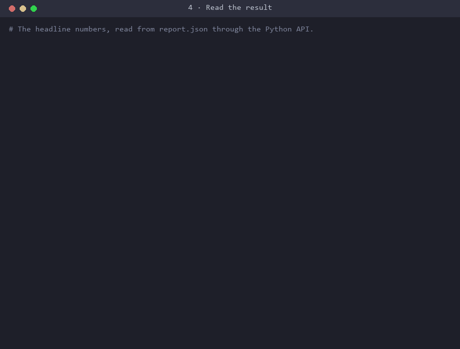
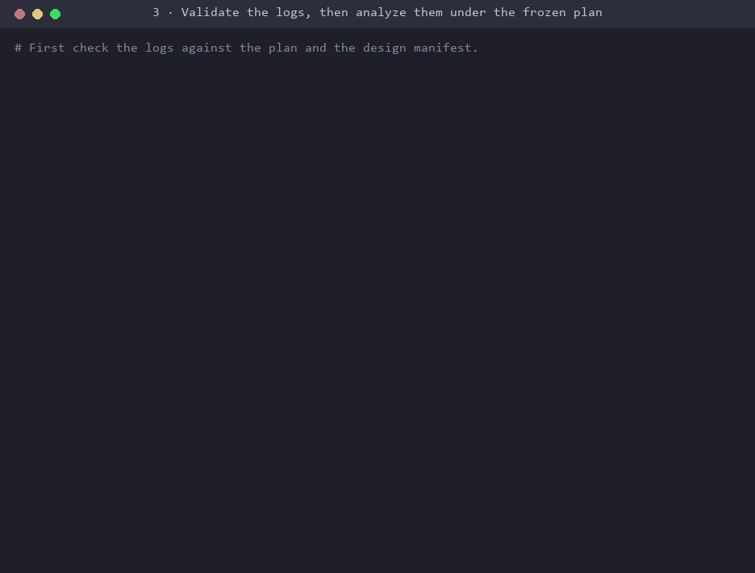

# Offline demo

The demo runs a 12-prompt refusal evaluation in Inspect for two configurations, a baseline and a
candidate, then analyzes the logs under a frozen plan and compares the two. It needs no API key
and takes about half a minute.

The model is simulated. [demo_eval.py](demo_eval.py) gives each configuration a fixed failure
probability for each prompt and seeds every draw with the configuration, the prompt and the
epoch. The scores, and so the numbers in the report, come out the same on every run and every
machine. They show how the analysis works and say nothing about any real model.

## Run it

From the repository root, after `python -m pip install -e .`:

```bash
python examples/demo/run_demo.py
```

The script writes the logs to `logs/demo` and the report to `reports/demo`, replacing the output
of an earlier demo run. It then prints the mean failure rate of each configuration, overall and
per risk domain, and the candidate-minus-baseline difference. Open `reports/demo/report.html` for
the interactive report.



## The same steps, one at a time

```bash
inspect eval examples/demo/demo_eval.py \
  --model mockllm/baseline,mockllm/candidate --log-dir logs/demo

inspect-safety-stats validate --plan examples/demo/plan.yaml --logs logs/demo

inspect-safety-stats analyze --plan examples/demo/plan.yaml \
  --logs logs/demo --output reports/demo

python examples/demo/show_results.py reports/demo
```



The name after `mockllm/` selects the simulated configuration. Start from an empty `logs/demo`,
since logs left there by an earlier run would be analyzed too. `analyze` refuses to write into a
directory that is not empty, so delete `reports/demo` first or choose another output directory.

## What to look at

`show_results.py` prints each mean failure rate with its 95% simultaneous interval. The baseline
fails on 5% of its bio rollouts, yet the interval runs from 0.000 to 0.312. Eighty rollouts do
not pin the rate down when the 95% has to hold for every displayed interval at once.

The candidate never fails on a cyber prompt, and its upper bound there is still 0.256. Clean
rollouts only bound the rate from above.

Over all prompts, the candidate-minus-baseline difference is -0.196, with an interval from -0.372
to -0.019. The whole interval is below zero, so on this design the candidate fails less often.

`report.md` and `report.json` also record the plan's SHA-256, the integrity checks and the methods
used, and `checksums.json` holds the SHA-256 of every other file in the report.

[Getting started](../../docs/getting-started.md) has recordings of each step.

## With a real model

Replace `simulated_model()` with `generate()` in [demo_eval.py](demo_eval.py), pass real model
names to `--model`, and change the `match` entries of the two cohorts in [plan.yaml](plan.yaml)
to those names. Replace the scorer as well. It only looks for the marker that the simulated
model writes, so a real model would pass every rollout. The
[fixed-design example](../fixed_design/README.md) and the
[HarmBench example](../real_harmbench/README.md) are real evaluations.
